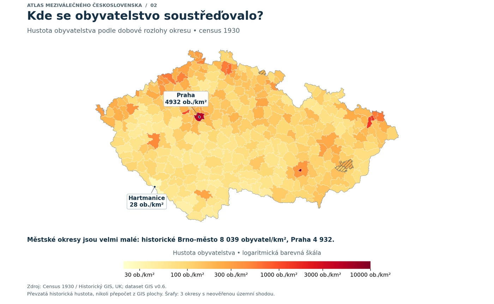

```{=html}
<!--| quarto-html-table-processing: none -->
<div class="ac-page gis-page" data-asset-root="assets/files/datasets/historical-gis/">
<a class="gis-back" href="data.html">← All datasets</a>

<header class="gis-hero">
  <div class="gis-hero-copy">
    <p class="gis-eyebrow">Historical data · Spatial perspectives</p>
    <h1>Czech Lands<br>Historical GIS</h1>
    <p class="gis-hero-subtitle">People, economy and place<br>in interwar Czechoslovakia</p>
    <p class="gis-hero-description">Follow a district across census tables, elections and climate. Put its population and economy into a landscape of rivers, soils and changing land use.</p>
    <div class="gis-hero-actions"><a class="gis-button gis-primary" href="#explore">Explore the map <span aria-hidden="true">↗</span></a><a class="gis-button gis-hero-secondary" href="#downloads">Get the data <span aria-hidden="true">↓</span></a></div>
    <p class="gis-release"><a href="https://adamdittrich.github.io/">Adam Dittrich</a> · Public edition 0.6.1<br><span>4 November 2026 · Based on research release 0.6</span></p>
  </div>
  <figure class="gis-hero-figure">
    <div id="gis-hero-map"></div>
    <figcaption><span class="gis-coordinate-label">BOHEMIA · MORAVIA · CZECH SILESIA</span><span id="gis-hero-caption">Historical boundaries, connected evidence</span></figcaption>
  </figure>
</header>

<div class="gis-facts" aria-label="Dataset at a glance">
  <div><strong>330</strong><span>Judicial districts<br>in the main 1930 geography</span></div>
  <div><strong>462</strong><span>Fields in the research master<br>including identifiers and diagnostics</span></div>
  <div><strong>1901–1938</strong><span>Monthly and annual<br>climate series</span></div>
  <div><strong>42 maps</strong><span>39 atlas figures<br>with definitions and commentary</span></div>
</div>

<p class="gis-scope"><strong>Geographical scope:</strong> the Czech lands, with the historical district boundaries preserved. Slovakia and Subcarpathian Ruthenia are outside this collection. Coverage and observation dates vary by variable; a blank is not a zero.</p>
<nav class="gis-onpage" aria-label="On this page"><a href="#explore">District explorer</a><a href="#climate">Climate through time</a><a href="#coverage">What is included</a><a href="#atlas">Map gallery</a><a href="#dictionary">Variable dictionary</a><a href="#downloads">Downloads &amp; R</a><a href="#methods">Methods &amp; sources</a></nav>

<noscript><p class="gis-notice">The interactive explorer needs JavaScript. The map above, methods and examples remain readable. Download the <a href="assets/files/datasets/historical-gis/GIS_Czech_Lands_Public_v0_6_1.zip">public data edition</a> to work with the files locally.</p></noscript>

<section id="explore" class="gis-section">
  <div class="gis-section-heading"><span class="gis-section-number">01</span><div><p class="gis-eyebrow">Start with a place</p><h2>One district, many perspectives</h2><p class="gis-section-intro">Choose a measure, then select a district on the map or by name. Every view keeps its unit, source period and coverage visible.</p></div></div>
  <div class="gis-workbench">
    <div class="gis-controls gis-map-controls">
      <label class="gis-control gis-control-metric" for="gis-metric"><span>Map a measure</span><select id="gis-metric" disabled><option>Loading measures…</option></select></label>
      <div class="gis-control gis-control-district"><label for="gis-district-search">Find a district</label><input id="gis-district-search" type="search" placeholder="Semily, Vrchlabí, Praha…" autocomplete="off" aria-controls="gis-district"><label class="gis-sr-only" for="gis-district">Select a district</label><select id="gis-district" disabled><option>Loading districts…</option></select></div>
      <label class="gis-control gis-control-scale" for="gis-classification"><span>Colour classes</span><select id="gis-classification"><option value="quantile">Quantiles of districts</option><option value="equal">Equal value intervals</option></select></label>
    </div>
    <div class="gis-map-year-row" id="gis-map-year-control" hidden><label for="gis-map-year">Map year <strong id="gis-map-year-label">1930</strong></label><input id="gis-map-year" type="range" min="1901" max="1938" step="1" value="1930"><span>Fixed district boundaries: 1930</span></div>
    <div class="gis-map-title-row"><div><h3 id="gis-map-title">Population density</h3><p id="gis-map-period" class="gis-small">Census 1930 · Judicial districts 1930</p></div><div class="gis-map-tools"><button type="button" class="gis-text-button" id="gis-focus-district" disabled>Focus district</button><button type="button" class="gis-text-button" id="gis-reset-map" disabled>Show all</button></div></div>
    <div class="gis-map-layout">
      <figure class="gis-map-figure">
        <div class="gis-map-canvas" id="gis-map-canvas" aria-busy="true"><div class="gis-tooltip" id="gis-map-tooltip" role="tooltip" hidden></div></div>
        <div class="gis-map-legend" id="gis-map-legend" aria-label="Map legend"></div>
        <figcaption class="gis-map-caption" id="gis-map-description">Loading the interactive map. The static atlas and downloadable files are available below.</figcaption>
      </figure>
      <aside class="gis-district-card" aria-labelledby="gis-district-name">
        <p class="gis-eyebrow">Selected district · 1930 boundaries</p><h3 id="gis-district-name">Semily</h3><p class="gis-district-id" id="gis-district-id">CZ1930-J-30102</p>
        <div class="gis-selected-measure"><span id="gis-selected-label">Population, census 1930</span><strong id="gis-selected-value">17,749</strong><span id="gis-selected-unit">people</span></div>
        <p id="gis-selected-context" class="gis-small"></p><dl id="gis-district-profile" class="gis-profile-list"></dl><div id="gis-district-flags" class="gis-quality-flags"></div>
        <button type="button" class="gis-text-button" id="gis-district-csv" disabled>Explorer profile (CSV)</button>
      </aside>
    </div>
    <div class="gis-map-summary" id="gis-map-summary" aria-live="polite"></div>
    <p class="gis-source-line" id="gis-map-source"></p><p class="gis-quality-note" id="gis-map-quality" hidden></p>
    <div class="gis-chart-actions"><button type="button" class="gis-text-button" id="gis-map-csv" disabled>Map values (CSV)</button><button type="button" class="gis-text-button" id="gis-map-svg" disabled>Map figure (SVG)</button><a href="#dictionary">Inspect definitions</a><span class="gis-status" id="gis-map-status" role="status"></span></div>
  </div>
  <p class="gis-caption">Use the district selector for a keyboard-friendly route through the map. Grey polygons indicate unavailable or withheld values. Colour classes describe the displayed data; they are not thresholds of historical significance. The profile CSV contains the explorer’s curated measures; the complete district tables are in <a href="#downloads">Downloads</a>.</p>
</section>

<section id="climate" class="gis-section">
  <div class="gis-section-heading"><span class="gis-section-number">02</span><div><p class="gis-eyebrow">Add the time dimension</p><h2>Climate through time</h2><p class="gis-section-intro">Follow annual conditions in the selected district, or compare it with another place. The same 1930 boundary is used throughout 1901–1938.</p></div></div>
  <figure class="gis-chart-card">
    <div class="gis-controls"><label class="gis-control" for="gis-climate-metric"><span>Annual measure</span><select id="gis-climate-metric" disabled><option>Loading climate…</option></select></label><label class="gis-control gis-control-comparison" for="gis-climate-comparison"><span>Compare with</span><select id="gis-climate-comparison" disabled><option value="">No comparison</option></select></label></div>
    <div class="gis-chart-heading"><h3 id="gis-climate-title">Semily · annual climate</h3><span id="gis-climate-unit" class="gis-small"></span></div><div id="gis-climate-legend" class="gis-series-legend"></div>
    <div id="gis-climate-plot" class="gis-climate-plot" aria-busy="true"><p class="gis-empty">Loading annual observations…</p></div>
    <div class="gis-year-readout"><label for="gis-climate-year"><span>Read a year <strong id="gis-climate-year-label">1930</strong></span><input id="gis-climate-year" type="range" min="1901" max="1938" step="1" value="1930"></label><div id="gis-climate-readout" aria-live="polite"></div></div>
    <figcaption class="gis-caption" id="gis-climate-caption">CRU-TS v4.10, area-weighted to historical districts. The shaded period marks 1918–1938. The 330 district series use 60 source cells at 0.5° resolution, so neighbouring districts can share climate information.</figcaption>
    <div class="gis-chart-actions"><button type="button" class="gis-text-button" id="gis-climate-csv" disabled>Displayed series (CSV)</button><button type="button" class="gis-text-button" id="gis-climate-svg" disabled>Climate figure (SVG)</button></div>
  </figure>
</section>

<section id="coverage" class="gis-section">
  <div class="gis-section-heading"><span class="gis-section-number">03</span><div><p class="gis-eyebrow">A connected collection</p><h2>What the dataset contains</h2><p class="gis-section-intro">Historical observations, reconstructed spatial measures and modern geographical context serve different purposes. Their dates remain separate in the data and in the explorer.</p></div></div>
  <div class="gis-time-key"><span><i class="gis-dot historical"></i> Historical observations</span><span><i class="gis-dot derived"></i> Spatially derived measures</span><span><i class="gis-dot context"></i> Geographical context</span></div>
  <div id="gis-module-grid" class="gis-module-grid"><article class="gis-module-card"><span class="gis-module-period">1921 &amp; 1930</span><h3>Census &amp; population</h3><p>Population, age, sex, marital status, religion and economic structure, with the source categories and denominators preserved.</p></article><article class="gis-module-card"><span class="gis-module-period">1901–1938</span><h3>Climate</h3><p>Monthly and annual CRU-TS variables, seasonal summaries, anomalies and station-support diagnostics.</p></article><article class="gis-module-card"><span class="gis-module-period">Source-specific dates</span><h3>Landscape &amp; spatial context</h3><p>Terrain, rivers, soils, land use, geology, boundaries and reference localities, each carrying its own observation date and method.</p></article></div>
  <details class="gis-details"><summary>Which administrative boundaries are available?</summary><div class="gis-details-body"><div class="gis-table-wrap"><table><thead><tr><th scope="col">Geography</th><th scope="col">Units</th><th scope="col">Role</th></tr></thead><tbody><tr><th scope="row">Judicial districts, 1930</th><td>330</td><td>Main geography and web explorer</td></tr><tr><th scope="row">Judicial districts, 1921</th><td>328</td><td>Alternative historical geography</td></tr><tr><th scope="row">Political districts, 1930</th><td>151</td><td>Broader administrative units</td></tr><tr><th scope="row">Political districts, 1921</th><td>151</td><td>Partly incomplete historical geometry</td></tr></tbody></table></div><p>These geographies overlap. They do not constitute 960 independent territories. Some political-district census attributes are area-weighted estimates; consult the accompanying source and method fields.</p></div></details>
</section>

<section id="atlas" class="gis-section">
  <div class="gis-section-heading"><span class="gis-section-number">04</span><div><p class="gis-eyebrow">Look across the country</p><h2>The atlas, map by map</h2><p class="gis-section-intro">Browse population, economic structure, politics and the landscape. Open a figure to read its full legend and source notes. Original atlas figures retain their Czech annotations.</p></div></div>
  <div class="gis-gallery-toolbar"><div id="gis-gallery-filters" class="gis-filter-buttons" role="group" aria-label="Filter map gallery"></div><label class="gis-control gis-gallery-search" for="gis-gallery-search"><span class="gis-sr-only">Search maps</span><input id="gis-gallery-search" type="search" placeholder="Search a topic or period…" autocomplete="off"></label></div>
  <p class="gis-gallery-count gis-small" id="gis-gallery-count" aria-live="polite">Loading the atlas catalogue…</p><div id="gis-gallery" class="gis-gallery"></div><div class="gis-gallery-more"><button type="button" class="gis-button" id="gis-gallery-more" hidden>Show more maps</button></div>
  <p class="gis-caption">Examples identify spatial patterns and useful research questions. A visual association is not a causal estimate. Later land-use observations and modern environmental models are explicitly dated in their maps.</p>
</section>

<section id="dictionary" class="gis-section">
  <div class="gis-section-heading"><span class="gis-section-number">05</span><div><p class="gis-eyebrow">Read the definitions</p><h2>A dictionary behind every field</h2><p class="gis-section-intro">Search names, units, periods and source descriptions. The field count includes join keys, coverage diagnostics and alternative definitions as well as substantive measurements.</p></div></div>
  <div class="gis-dictionary-card"><div class="gis-controls"><label class="gis-control gis-control-search" for="gis-dictionary-search"><span>Find a variable</span><input id="gis-dictionary-search" type="search" placeholder="Try population, precipitation, soil, 1930…" autocomplete="off"></label><label class="gis-control" for="gis-dictionary-group"><span>Module</span><select id="gis-dictionary-group"><option value="all">All modules</option></select></label></div>
    <p id="gis-dictionary-count" class="gis-small" aria-live="polite">Loading definitions…</p><div class="gis-table-wrap gis-dictionary-table"><table id="gis-dictionary-table"><thead><tr><th scope="col">Field &amp; definition</th><th scope="col">Period</th><th scope="col">Unit</th><th scope="col">Coverage / source</th></tr></thead><tbody></tbody></table></div>
    <div class="gis-table-actions"><div class="gis-pagination"><button type="button" class="gis-button" id="gis-dictionary-prev" disabled>← Previous</button><span id="gis-dictionary-page" class="gis-small"></span><button type="button" class="gis-button" id="gis-dictionary-next" disabled>Next →</button></div><button type="button" class="gis-text-button" id="gis-dictionary-csv" disabled>Download matching definitions (CSV)</button></div>
  </div>
</section>

<section id="downloads" class="gis-section">
  <div class="gis-section-heading"><span class="gis-section-number">06</span><div><p class="gis-eyebrow">Take the data into your research</p><h2>Downloads &amp; practical examples</h2><p class="gis-section-intro">Start with a district table, open the spatial edition in QGIS, or use the R interface. All 462 source fields are supplied across the 444-field core and 18 separately licensed climate fields, joined by district ID. Publication quality flags are provided separately.</p></div></div>
  <div id="gis-downloads" class="gis-downloads">
    <div class="gis-download-row"><div><h3>Public research edition 0.6.1</h3><p>GeoPackage, district tables, documentation, quality flags and reproducible examples.</p></div><a class="gis-button gis-primary" href="assets/files/datasets/historical-gis/GIS_Czech_Lands_Public_v0_6_1.zip" download>Download edition (ZIP) ↓</a></div>
    <div class="gis-download-row"><div><h3>Complete tabular edition</h3><p>CSV tables for all four geographies and the complete climate and railway panels.</p></div><a class="gis-button" href="assets/files/datasets/historical-gis/GIS_Czech_Lands_Tables_v0_6_1.zip" download>Download tables (ZIP) ↓</a></div>
    <div class="gis-download-row"><div><h3>Historical map atlas</h3><p>42 maps in 39 original-resolution figures, with definitions and commentary.</p></div><a class="gis-button" href="assets/files/datasets/historical-gis/Czech_Lands_Historical_Atlas_42_maps.zip" download>Download atlas (ZIP) ↓</a></div>
    <div class="gis-download-row"><div><h3>histCzechia 0.2.1</h3><p>Companion R source package with examples and public-edition support.</p></div><a class="gis-button" href="assets/files/datasets/historical-gis/histCzechia_0.2.1.tar.gz" download>Download R package ↓</a></div>
  </div>
  <div class="gis-quickstart-grid">
    <article class="gis-example"><p class="gis-eyebrow">R · join the documented components</p><h3>Start with Semily</h3><p>After unzipping the public edition, join the district core and the separately licensed climate component by their stable district identifier.</p><pre id="gis-r-example"><code>core &lt;- read.csv(
  "data/gis_master_judicial_1930_public_v061.csv",
  check.names = FALSE
)
climate &lt;- read.csv(
  "data/climate_normals_judicial_1930.csv",
  check.names = FALSE
)

climate$geography &lt;- NULL
districts &lt;- merge(
  core, climate, by = "district_year_id",
  all.x = TRUE, sort = FALSE
)

semily &lt;- subset(
  districts,
  district_year_id == "CZ1930-J-30102"
)

semily[c("district_year_id", "NAZEV", "population")]
</code></pre><button type="button" class="gis-text-button" data-copy="gis-r-example">Copy R example</button></article>
    <article class="gis-example"><p class="gis-eyebrow">QGIS &amp; joins</p><h3>Keep space and time explicit</h3><p>Open the district GeoPackage and select <code>judicial_1930</code>. Join a thematic table only after choosing its observation year or date.</p><dl class="gis-join-keys"><div><dt>District record</dt><dd><code>district_year_id</code></dd></div><div><dt>Annual series</dt><dd><code>geography</code> + <code>district_year_id</code> + <code>calendar_year</code></dd></div><div><dt>Monthly climate</dt><dd>Add <code>month</code> to the annual key.</dd></div><div><dt>Historical border snapshot</dt><dd>Use the exact <code>snapshot_id</code>; 1938 has several distinct dates.</dd></div></dl><p class="gis-caption">Repeating a static attribute in an annual panel does not make it a new observation each year.</p></article>
  </div>
  <details class="gis-details"><summary>About the histCzechia R interface</summary><div class="gis-details-body"><p><code>histCzechia</code> is a companion source package with functions for districts, climate, rivers and the extension modules. Version 0.2.1 adds support for this public GeoPackage. It reads a separately supplied database and validates supported release checksums. It is not on CRAN.</p><p>Use the installation and compatibility instructions supplied with the public edition. A repackaged or independently rebuilt GeoPackage can have a different checksum from the original research release.</p></div></details>
</section>

<section id="methods" class="gis-section">
  <div class="gis-section-heading"><span class="gis-section-number">07</span><div><p class="gis-eyebrow">Trace the evidence</p><h2>Methods, coverage and source credit</h2><p class="gis-section-intro">The collection combines existing sources through documented spatial joins and transformations. Source dates, definitions and limitations travel with the values.</p></div></div>
  <div class="gis-methods-grid">
    <article><h3>Historical observation or later context?</h3><p>The 1930 census describes a historical population. CRU provides a historical climate series. SoilGrids is a modern soil model; the geological map is a later publication, and the mineral inventory does not establish which mines operated in 1930. Land use retains its actual source years.</p></article>
    <article><h3>Denominators change the meaning</h3><p>Economic shares can refer to active people with a known sector or to the whole population. Religious diversity includes a category for no religion. Age ratios describe age groups, not observed economic dependency. The dictionary specifies these choices.</p></article>
    <article><h3>District averages have a resolution</h3><p>Climate is weighted by district–grid overlap. Several districts may share the same CRU cell. Land-use categories are allocated from larger source units, and modern soil means describe their valid modelled area. Fine district boundaries do not create finer source information.</p></article>
    <article><h3>Missingness remains visible</h3><p>Insufficient coverage, unresolved source records and territorial inconsistencies are flagged. Curated map measures can withhold values while preserving the research source fields and the reason for exclusion. Missing values are never coloured as zero.</p></article>
  </div>
  <details class="gis-details"><summary>Specific issues behind the atlas views</summary><div class="gis-details-body"><ul><li><strong>Economic categories:</strong> Vsetín and Vejprty have source economic records awaiting verification; the affected curated economic maps withhold these values.</li><li><strong>Territorial agreement:</strong> Žacléř, Napajedla and Zlín have material differences between historical reported area and GIS area. This flags the spatial match, not an automatic error in the census count.</li><li><strong>Brno elections:</strong> the two Brno records are withheld from the curated 1935 vote-count comparison pending an explicit reconciliation of electoral and judicial territories. The contemporary census confirms the distinct judicial and municipal units.</li><li><strong>Climate:</strong> the 330 districts use 60 CRU cells. A positive station-support flag is not a count of stations physically located inside a district. Frost frequency is empirically derived, not a local event register.</li><li><strong>Weather and election timing:</strong> April–September 1935 extends beyond the May 1935 election. This seasonal interval must not be treated as a wholly pre-election weather exposure.</li><li><strong>Railway chronology:</strong> Horní Lideč–Púchov opened in 1937 and is excluded from the corrected 1930 network. Poříčany–Nymburk remains absent where the source lacks geometry.</li><li><strong>Land use and soils:</strong> a change between 1845 and 1948 cannot be assigned wholly to the interwar years. Modern modelled clay content does not directly measure historical fertility.</li></ul></div></details>
  <div class="gis-source-panel"><h3>Underlying sources</h3><p class="gis-caption">Please cite both this compilation and the sources used in your analysis. Their own terms continue to apply; the collection has no blanket data licence.</p><div class="gis-source-grid"><a href="https://www.historickygis.cz/cs/o-aplikaci-interaktivni-mapa-obyvatelstva-1921-2011" target="_blank" rel="noopener"><strong>Historický GIS · Charles University</strong><span>Historical districts and census categories ↗</span></a><a href="https://csu.gov.cz/" target="_blank" rel="noopener"><strong>Czech Statistical Office</strong><span>Census and historical electoral sources ↗</span></a><a href="https://crudata.uea.ac.uk/cru/data/hrg/cru_ts_4.10/" target="_blank" rel="noopener"><strong>CRU-TS v4.10 · UEA</strong><span>Monthly climate grids ↗</span></a><a href="https://www.hydrosheds.org/" target="_blank" rel="noopener"><strong>HydroSHEDS</strong><span>HydroRIVERS and HydroBASINS ↗</span></a><a href="https://docs.isric.org/globaldata/soilgrids/" target="_blank" rel="noopener"><strong>ISRIC · SoilGrids 2.0</strong><span>Modern soil predictions ↗</span></a><a href="https://web.natur.cuni.cz/ksgrrsek/lucc/" target="_blank" rel="noopener"><strong>LUCC Czechia · Bičík and colleagues</strong><span>Historical land-use snapshots ↗</span></a><a href="https://dprace.geoinf.upol.cz/dprace/magisterske/bedrunka23/" target="_blank" rel="noopener"><strong>Ondřej Bedrunka · Palacký University</strong><span>Historical railway database ↗</span></a><a href="https://cgs.gov.cz/en/maps-and-data/provision-of-data" target="_blank" rel="noopener"><strong>Czech Geological Survey</strong><span>Geology and mineral-resource inventories ↗</span></a><a href="https://icr.ethz.ch/data/cshapes/" target="_blank" rel="noopener"><strong>CShapes 2.0</strong><span>Historical state-boundary snapshots ↗</span></a><a href="https://sovamm.wordpress.com/projekty/aktualni-projekty-sovamm/cz_retro/" target="_blank" rel="noopener"><strong>Karel Kuča · SOVAMM · CZ_RETRO</strong><span>Reference localities and historical place names ↗</span></a></div></div>
  <p class="gis-caption"><strong>Historical GIS acknowledgment:</strong> historical census and district data originate from the geodatabase by Jíchová, Soukup, Nemeškal, Ouředníček, Pospíšilová, Svoboda, Špačková and colleagues (2014), URRlab, Faculty of Science, Charles University. The underlying work was supported by NAKI project DF12P01OVV033 and the Ministry of Culture of the Czech Republic.</p>
  <p class="gis-caption"><a href="assets/files/datasets/historical-gis/docs/SOURCES_AND_REUSE.md">Read the full source and reuse statement</a> · <a href="assets/files/datasets/historical-gis/sources.json" download>Download the source register (JSON)</a></p>
  <details class="gis-details"><summary>Full citations and reuse conditions by source</summary><div id="gis-source-register" class="gis-source-register"><p class="gis-caption">The complete citations, provider conditions and redistribution notes are also available in the linked source statement.</p></div></details>
  <div class="gis-citation"><p class="gis-eyebrow">Suggested citation</p><p id="gis-citation-text">Dittrich, Adam. 2026. <em>Czech Lands Historical GIS.</em> Public edition 0.6.1. https://adamdittrich.github.io/czech-lands-historical-gis.html.</p><button type="button" class="gis-text-button" data-copy="gis-citation-text">Copy citation</button><span class="gis-status" id="gis-copy-status" role="status"></span></div>
  <div class="gis-related"><span>Related data</span><a href="czechoslovak-foreign-trade.html">Foreign trade ↗</a><a href="czechoslovakia-eer.html">Effective exchange rates ↗</a><a href="czechoslovak-commercial-banking.html">Commercial banking ↗</a></div>
</section>

<dialog id="gis-lightbox" class="gis-lightbox" aria-labelledby="gis-lightbox-title"><div class="gis-lightbox-heading"><div><p id="gis-lightbox-period" class="gis-eyebrow"></p><h2 id="gis-lightbox-title">Atlas figure</h2></div><button type="button" class="gis-close" id="gis-lightbox-close" aria-label="Close map">×</button></div><p id="gis-lightbox-description"></p><p id="gis-lightbox-source" class="gis-caption"></p><p id="gis-lightbox-warning" class="gis-quality-note" hidden></p><div class="gis-lightbox-actions"><button type="button" class="gis-button" id="gis-lightbox-prev">← Previous</button><a id="gis-lightbox-download" class="gis-button gis-primary" href="#" download>Download image ↓</a><button type="button" class="gis-button" id="gis-lightbox-next">Next →</button></div></dialog>
</div>
```
