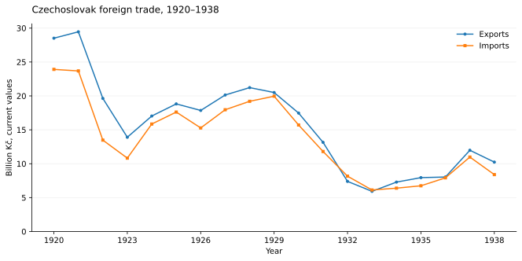
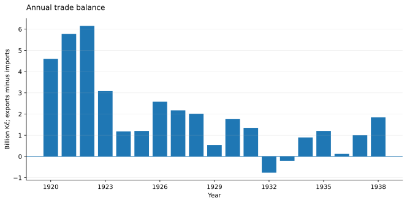
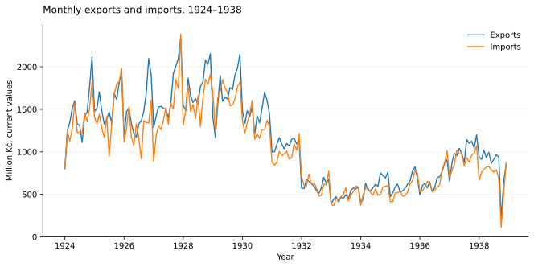
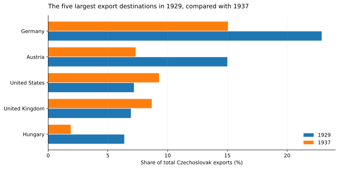

```{=html}
<div class="ac-page ds-page">
<p class="ac-back-link"><a href="data.html">← Datasets</a></p>
<h1>Czechoslovak foreign trade</h1>
<p class="ds-meta">Adam Dittrich · Annual: 1920–1938 · Monthly: January 1924–December 1938</p>
<p class="ds-lede">National exports, imports and trade balances, with annual bilateral trade for fifteen partners. Explore monthly exports and imports with moving averages and HP trends, then compare the trade balance, export coverage of imports and balance relative to total trade. The workbook also contains partner shares, growth rates and indices with 1929 as the reference year.</p>
<nav aria-label="On this page" class="ds-nav"><a href="#monthly-explorer">Monthly explorer</a><a href="#figures">Figures</a><a href="#coverage">Coverage and units</a><a href="#monthly-methods">Methods</a><a href="#downloads">Downloads</a><a href="#citation">Citation</a></nav>
<div class="ds-facts"><div><strong>19 years</strong><span>Annual national and partner tables, 1920–1938.</span></div><div><strong>180 months</strong><span>National totals, January 1924–December 1938.</span></div><div><strong>15 partners</strong><span>285 annual partner observations; a selected sample, not the entire world.</span></div></div>
<section class="ds-section ft-explorer" id="monthly-explorer" aria-labelledby="ft-heading" data-source="assets/files/datasets/foreign-trade-analysis/monthly-analysis.json">
  <p class="ft-eyebrow">Explore the monthly series</p>
  <h2 id="ft-heading">Trade flows, trends and balances</h2>
  <p>Compare the observed monthly values with a moving average or HP trend. The balance and ratios use the same exports and imports as the selected view.</p>
  <p id="ft-load-status" class="ft-status" role="status">Loading the monthly explorer…</p>
  <button type="button" id="ft-retry" class="ft-button" hidden>Try loading again</button>
  <noscript><p>Interactive controls require JavaScript. <a href="assets/files/datasets/foreign-trade-analysis/monthly-analysis.csv">Download all monthly observations and trends as CSV</a>, or use the figures below.</p></noscript>
  <div id="ft-content" hidden>
    <div class="ft-controls">
      <div class="ft-field ft-method-field"><label for="ft-method">Smoothing</label><select id="ft-method" aria-describedby="ft-method-note"><option value="trailing12">12-month trailing average</option></select></div>
      <div class="ft-field"><label for="ft-start">From</label><input type="month" id="ft-start" min="1924-01" max="1938-12" value="1924-01"></div>
      <div class="ft-field"><label for="ft-end">To</label><input type="month" id="ft-end" min="1924-01" max="1938-12" value="1938-12"></div>
      <label class="ft-check"><input type="checkbox" id="ft-observed" checked><span>Show observed values</span></label>
    </div>
    <div class="ft-toolbar">
      <div class="ft-presets" role="group" aria-label="Choose a date range"><button type="button" class="ft-button" data-ft-range="1924-01,1938-12">Full period</button><button type="button" class="ft-button" data-ft-range="1929-01,1938-12">1929–1938</button><button type="button" class="ft-button" data-ft-range="1931-01,1937-12">1931–1937</button></div>
      <button type="button" class="ft-button" id="ft-download-csv">Download selection CSV</button>
    </div>
    <p id="ft-range-error" class="ft-error" role="alert" hidden></p>
    <p id="ft-method-note" class="ft-method-note"></p>
    <p class="ft-global-note">Values are in million current Kč unless shown as percentages. Smoothing does not adjust for prices or provide formal seasonal adjustment.</p>
    <figure class="ft-card ft-card-wide" data-ft-chart="flows">
      <div class="ft-card-heading"><div><h3>Exports and imports</h3><p class="ft-unit">Million current Kč · monthly values</p></div><div class="ft-chart-actions"><button type="button" class="ft-button" data-ft-enlarge="flows" aria-label="Enlarge exports and imports chart">Enlarge</button><button type="button" class="ft-button" data-ft-svg="flows" aria-label="Download exports and imports chart as SVG">SVG</button></div></div>
      <div class="ft-legend"><span><i style="--ft-color:#1f77b4"></i>Exports</span><span><i class="ft-dashed" style="--ft-color:#ff7f0e"></i>Imports</span><span class="ft-raw-key">Faint lines: observed values</span></div>
      <div id="ft-chart-flows" class="ft-chart"></div>
      <figcaption>Hover or tap a chart to inspect a month. Use the month slider or the arrow keys when a chart is focused.</figcaption>
    </figure>
    <div class="ft-inspection" aria-labelledby="ft-inspection-title">
      <div class="ft-inspection-heading"><label for="ft-month" id="ft-inspection-title">Inspect a month</label><output for="ft-month" id="ft-selected-month"></output></div>
      <input type="range" id="ft-month" min="0" max="179" value="71" step="1" aria-describedby="ft-readout-note">
      <p id="ft-readout-note" class="ft-readout-note">The larger values show the selected method; observed monthly values appear underneath.</p>
      <dl id="ft-readout" class="ft-readout"></dl>
    </div>
    <div class="ft-chart-grid">
      <figure class="ft-card" data-ft-chart="balance"><div class="ft-card-heading"><div><h3>Trade balance</h3><p class="ft-unit">Exports − imports · million current Kč</p></div><div class="ft-chart-actions"><button type="button" class="ft-button" data-ft-enlarge="balance" aria-label="Enlarge trade balance chart">Enlarge</button><button type="button" class="ft-button" data-ft-svg="balance" aria-label="Download trade balance chart as SVG">SVG</button></div></div><div id="ft-chart-balance" class="ft-chart"></div><figcaption>Above zero: a surplus. Below zero: a deficit.</figcaption></figure>
      <figure class="ft-card" data-ft-chart="coverage"><div class="ft-card-heading"><div><h3>Export coverage of imports</h3><p class="ft-unit">100 × exports / imports · %</p></div><div class="ft-chart-actions"><button type="button" class="ft-button" data-ft-enlarge="coverage" aria-label="Enlarge export coverage chart">Enlarge</button><button type="button" class="ft-button" data-ft-svg="coverage" aria-label="Download export coverage chart as SVG">SVG</button></div></div><div id="ft-chart-coverage" class="ft-chart"></div><figcaption>100% means exports equal imports; 120% means exports are 1.2 times imports.</figcaption></figure>
      <figure class="ft-card" data-ft-chart="normalized"><div class="ft-card-heading"><div><h3>Balance relative to total trade</h3><p class="ft-unit">100 × (exports − imports) / (exports + imports) · %</p></div><div class="ft-chart-actions"><button type="button" class="ft-button" data-ft-enlarge="normalized" aria-label="Enlarge balance relative to total trade chart">Enlarge</button><button type="button" class="ft-button" data-ft-svg="normalized" aria-label="Download balance relative to total trade chart as SVG">SVG</button></div></div><div id="ft-chart-normalized" class="ft-chart"></div><figcaption>A scale-free measure of the trade imbalance. Zero means balanced trade.</figcaption></figure>
      <figure class="ft-card" data-ft-chart="turnover"><div class="ft-card-heading"><div><h3>Total trade</h3><p class="ft-unit">Exports + imports · million current Kč</p></div><div class="ft-chart-actions"><button type="button" class="ft-button" data-ft-enlarge="turnover" aria-label="Enlarge total trade chart">Enlarge</button><button type="button" class="ft-button" data-ft-svg="turnover" aria-label="Download total trade chart as SVG">SVG</button></div></div><div id="ft-chart-turnover" class="ft-chart"></div><figcaption>The combined value of exports and imports.</figcaption></figure>
    </div>
    <details class="ft-table-details"><summary>Inspect the selected monthly values</summary><p id="ft-table-note" class="ft-global-note"></p><div class="ds-table-scroll ft-table-scroll" tabindex="0" role="region" aria-label="Scrollable monthly trade table"><table class="ds-table"><caption id="ft-table-caption">Monthly trade values</caption><thead><tr><th scope="col">Month</th><th scope="col" class="num">Exports</th><th scope="col" class="num">Imports</th><th scope="col" class="num">Balance</th><th scope="col" class="num">Coverage (%)</th><th scope="col" class="num">Balance / trade (%)</th><th scope="col" class="num">Total trade</th></tr></thead><tbody id="ft-table-body"></tbody></table></div></details>
    <p class="ft-source-note">Source: the monthly totals in <em>Czechoslovak Foreign Trade: Interwar Dataset</em>. <a href="assets/files/datasets/foreign-trade-analysis/monthly-analysis.csv" download>All methods (CSV)</a> · <a href="assets/files/datasets/foreign-trade-analysis/README.txt">Definitions and methods</a></p>
  </div>
  <dialog id="ft-dialog" class="ft-dialog" aria-labelledby="ft-dialog-title"><div class="ft-dialog-top"><div><h2 id="ft-dialog-title">Monthly trade</h2><p id="ft-dialog-method"></p></div><button type="button" class="ft-button" id="ft-dialog-close" autofocus>Close</button></div><div id="ft-dialog-legend" class="ft-legend"></div><div id="ft-dialog-chart" class="ft-chart"></div><p id="ft-dialog-readout" class="ft-dialog-readout" aria-live="polite"></p><p id="ft-dialog-note" class="ft-global-note"></p><button type="button" class="ft-button" id="ft-dialog-svg">Download SVG</button></dialog>
</section>

<section class="ds-section" id="figures"><h2>What the data show</h2>
<h3>Trade values contracted sharply after 1929</h3>
<p>Between 1929 and 1933, annual export values fell by <strong>71.1%</strong> and import values by <strong>69.3%</strong>. Exports recovered to 58.5% of their 1929 value by 1937. These are changes in <em>current-price trade values</em>, not estimates of changes in physical trade volumes.</p>
<figure class="ds-figure"><figcaption>Source: <em>Annual totals</em>. The chart divides the workbook’s million-Kč values by 1,000; no price adjustment is applied.<span class="ds-image-links"><a download="" href="assets/files/datasets/foreign-trade-annual.csv">Chart data (CSV)</a> · <a href="assets/files/datasets/figures/trade-annual.svg">Open figure</a> · <a href="assets/files/datasets/figures/trade-annual.png">PNG</a></span></figcaption></figure>
<h3>The balance turned negative in 1932 and 1933</h3>
<p>The annual series records deficits of <strong>766.0 million Kč in 1932</strong> and <strong>202.2 million Kč in 1933</strong>, followed by a surplus of <strong>896.0 million Kč in 1934</strong>. A surplus alone does not establish an export-led recovery: it can also reflect falling imports.</p>
<figure class="ds-figure"><figcaption>Source: <em>Annual totals</em>. Trade balance = exports − imports.<span class="ds-image-links"><a download="" href="assets/files/datasets/foreign-trade-annual.csv">Chart data (CSV)</a> · <a href="assets/files/datasets/figures/trade-balance.svg">Open figure</a> · <a href="assets/files/datasets/figures/trade-balance.png">PNG</a></span></figcaption></figure>
<h3>Monthly observations reveal movements hidden by annual totals</h3>
<p>The monthly table retains the supplied observations and their within-year variation. The chart applies no additional seasonal adjustment.</p>
<figure class="ds-figure"><figcaption>Source: <em>Monthly totals</em>.<span class="ds-image-links"><a download="" href="assets/files/datasets/foreign-trade-monthly.csv">Chart data (CSV)</a> · <a href="assets/files/datasets/figures/trade-monthly.svg">Open figure</a> · <a href="assets/files/datasets/figures/trade-monthly.png">PNG</a></span></figcaption></figure>
<h3>The distribution of exports changed</h3>
<p>Germany’s share of national exports declined from 22.89% in 1929 to 15.05% in 1937; Austria’s declined from 15.00% to 7.32%. The figure follows the five largest destinations in the supplied 1929 partner table, keeping the same selection in 1937.</p>
<figure class="ds-figure"><figcaption>Source: <em>Annual partners</em>. Shares use national exports as the denominator, not exports to the selected five countries.<span class="ds-image-links"><a download="" href="assets/files/datasets/foreign-trade-partners.csv">Chart data (CSV)</a> · <a href="assets/files/datasets/figures/trade-partners.svg">Open figure</a> · <a href="assets/files/datasets/figures/trade-partners.png">PNG</a></span></figcaption></figure>
<details><summary>View the complete annual national table</summary><div class="ds-table-scroll"><table class="ds-table"><caption>Annual national totals; million Kč at current values</caption><thead><tr><th scope="col">Year</th><th class="num" scope="col">Exports</th><th class="num" scope="col">Imports</th><th class="num" scope="col">Balance</th></tr></thead><tbody><tr><th scope="row">1920</th><td class="num">28,514.6</td><td class="num">23,912.3</td><td class="num">4,602.3</td></tr><tr><th scope="row">1921</th><td class="num">29,458.0</td><td class="num">23,685.4</td><td class="num">5,772.6</td></tr><tr><th scope="row">1922</th><td class="num">19,632.9</td><td class="num">13,477.6</td><td class="num">6,155.2</td></tr><tr><th scope="row">1923</th><td class="num">13,903.3</td><td class="num">10,820.9</td><td class="num">3,082.4</td></tr><tr><th scope="row">1924</th><td class="num">17,035.4</td><td class="num">15,854.7</td><td class="num">1,180.7</td></tr><tr><th scope="row">1925</th><td class="num">18,821.1</td><td class="num">17,618.1</td><td class="num">1,203.0</td></tr><tr><th scope="row">1926</th><td class="num">17,856.6</td><td class="num">15,276.7</td><td class="num">2,579.9</td></tr><tr><th scope="row">1927</th><td class="num">20,135.4</td><td class="num">17,961.6</td><td class="num">2,173.8</td></tr><tr><th scope="row">1928</th><td class="num">21,224.2</td><td class="num">19,207.9</td><td class="num">2,016.3</td></tr><tr><th scope="row">1929</th><td class="num">20,498.9</td><td class="num">19,957.9</td><td class="num">541.0</td></tr><tr><th scope="row">1930</th><td class="num">17,473.7</td><td class="num">15,714.5</td><td class="num">1,759.2</td></tr><tr><th scope="row">1931</th><td class="num">13,149.4</td><td class="num">11,800.5</td><td class="num">1,348.9</td></tr><tr><th scope="row">1932</th><td class="num">7,391.9</td><td class="num">8,157.9</td><td class="num">-766.0</td></tr><tr><th scope="row">1933</th><td class="num">5,923.0</td><td class="num">6,125.2</td><td class="num">-202.2</td></tr><tr><th scope="row">1934</th><td class="num">7,287.5</td><td class="num">6,391.6</td><td class="num">896.0</td></tr><tr><th scope="row">1935</th><td class="num">7,946.6</td><td class="num">6,743.2</td><td class="num">1,203.5</td></tr><tr><th scope="row">1936</th><td class="num">8,036.4</td><td class="num">7,915.2</td><td class="num">121.2</td></tr><tr><th scope="row">1937</th><td class="num">11,982.7</td><td class="num">10,981.5</td><td class="num">1,001.1</td></tr><tr><th scope="row">1938</th><td class="num">10,234.5</td><td class="num">8,390.4</td><td class="num">1,844.2</td></tr></tbody></table></div></details>
</section>
<section class="ds-section" id="coverage"><h2>Coverage and units</h2>
<div class="ds-table-scroll"><table class="ds-table"><thead><tr><th scope="col">Sheet</th><th scope="col">Observations</th><th scope="col">Contents</th></tr></thead><tbody><tr><td>Annual totals</td><td>19 years</td><td>National exports, imports, balance, turnover, export–import ratio, growth rates and 1929-based indices.</td></tr><tr><td>Annual partners</td><td>285 partner-years</td><td>Exports, imports, bilateral balances and shares of national trade for fifteen partners.</td></tr><tr><td>Monthly totals</td><td>180 months</td><td>National totals and derived indicators; no monthly bilateral panel is included.</td></tr><tr><td>Monthly analysis extension</td><td>180 months × 6 methods</td><td>Observed flows, three trailing averages, a centered average and an HP trend, with consistently derived balances and ratios.</td></tr><tr><td>Charts</td><td>Visual summaries</td><td>Workbook charts and their source tables.</td></tr></tbody></table></div>
<p>Trade values are stored in <strong>million current Kč</strong>. Balance is exports minus imports; turnover is their sum. Ratios, shares and growth columns are expressed as percentage numbers. Annual indices use the annual 1929 value; monthly indices use the mean month of 1929.</p>
<details><summary>Included partners</summary><p>Austria; Belgium and Luxembourg; France; Germany; Hungary; Italy; Netherlands; Poland; Romania; Sweden; Switzerland; USSR; United Kingdom; United States; Yugoslavia.</p><p>The partner table is not exhaustive. Its shares need not sum to 100%. It is distinct from the fourteen-partner basket used in the <a href="czechoslovakia-eer.html">EER dataset</a>.</p></details>
<p class="ds-small">All figures use observations from the supplied workbook. The monthly analysis extension is dated 13 November 2026; source observations retain their original units and values.</p>
</section>
<details><summary>Download static monthly analysis figures</summary><ul><li><a href="assets/files/datasets/foreign-trade-analysis/monthly-flows.svg">Exports and imports, observed and 12-month average (SVG)</a></li><li><a href="assets/files/datasets/foreign-trade-analysis/monthly-balance.svg">Monthly trade balance (SVG)</a></li><li><a href="assets/files/datasets/foreign-trade-analysis/monthly-coverage.svg">Export coverage of imports (SVG)</a></li><li><a href="assets/files/datasets/foreign-trade-analysis/monthly-normalized-balance.svg">Balance relative to total trade (SVG)</a></li><li><a href="assets/files/datasets/foreign-trade-analysis/monthly-turnover.svg">Total monthly trade (SVG)</a></li><li><a href="assets/files/datasets/foreign-trade-analysis/monthly-hp-comparison.svg">Moving averages compared with HP trends (SVG)</a></li></ul><p class="ds-small">Each SVG includes its method, units and source. The interactive charts above also export the selected method and date range.</p></details>
<section class="ds-section" id="monthly-methods"><h2>How the monthly indicators are constructed</h2>
<p>Let <strong>X</strong> denote exports and <strong>M</strong> imports. For a smoothed view, the selected filter is applied to each flow first. The other indicators are then calculated from those same smoothed flows.</p>
<div class="ds-table-scroll"><table class="ds-table"><thead><tr><th scope="col">Indicator</th><th scope="col">Definition</th><th scope="col">How to read it</th></tr></thead><tbody>
<tr><td>Trade balance</td><td>X − M</td><td>Million current Kč; positive means a surplus and negative a deficit.</td></tr>
<tr><td>Export coverage of imports</td><td>100 × X / M</td><td>100% means exports equal imports; 120% means exports are 1.2 times imports.</td></tr>
<tr><td>Normalized trade balance</td><td>100 × (X − M) / (X + M)</td><td>Balance as a percentage of total trade; zero denotes balanced trade.</td></tr>
<tr><td>Total trade</td><td>X + M</td><td>Combined exports and imports in million current Kč.</td></tr>
</tbody></table></div>
<p>A smoothed export/import ratio is therefore a <strong>ratio of smoothed flows</strong>, rather than an average of monthly ratios. For the 12-month trailing average, it also equals the ratio of exports to imports summed over those twelve months.</p>
<details><summary>Moving averages, HP settings and unavailable values</summary>
<ul><li><strong>Trailing averages:</strong> the mean of the current month and the preceding 2, 5 or 11 months. All months in a window must be observed. These averages delay turning points; the 12-month option first becomes available in December 1924.</li>
<li><strong>Centered 12-month average:</strong> a standard 2 × 12-month average. It uses thirteen observations, with half-weight on each endpoint: weights 1/24 at t − 6 and t + 6, and 1/12 for each of the eleven intervening months. Six months at each end have no centered estimate.</li>
<li><strong>HP trend:</strong> the Hodrick–Prescott filter in levels, with monthly λ = 129,600, following the frequency adjustment of Ravn and Uhlig (2002). It uses the full available monthly sample; the date controls change the displayed interval without re-estimating the trend.</li>
<li><strong>Missing values:</strong> unavailable values remain blank, and ratios require a positive denominator. Moving averages require complete calendar windows. If future source data contain gaps, HP is fitted separately to common observed runs of at least 24 months.</li></ul>
<p>HP trends are descriptive smooth estimates. They use observations on both sides of a date and can be sensitive near sample boundaries and abrupt changes. Smoothing does not adjust for prices, perform a full seasonal adjustment or resolve changes in statistical coverage.</p>
</details>
<p class="ds-small">Method references: <a href="https://doi.org/10.1162/003465302317411604">Ravn and Uhlig (2002), <em>Review of Economics and Statistics</em> 84(2), 371–376</a>; <a href="https://otexts.com/fpp3/decomposition.html#moving-averages">Hyndman and Athanasopoulos, <em>Forecasting: Principles and Practice</em>, moving averages</a>. The <a href="assets/files/datasets/foreign-trade-analysis/README.txt">analysis documentation</a> includes the exact formulas, source checksum and reproduction instructions.</p>
</section>
<section class="ds-section ds-download" id="downloads"><h2>Download the data</h2><p>The monthly analysis includes all six methods, the derived indicators, static SVG figures and reproduction code. Dates use YYYY-MM-DD; unavailable values are blank in CSV and null in JSON.</p>
<div class="ds-download-links"><a download="" href="assets/files/datasets/foreign-trade-analysis/monthly-analysis.zip">Monthly analysis and code (ZIP)</a><a download="" href="assets/files/datasets/foreign-trade-analysis/monthly-analysis.csv">All monthly methods (CSV)</a><a download="" href="assets/files/datasets/foreign-trade-analysis/monthly-analysis.json">Monthly analysis (JSON)</a></div>
<p class="ds-small"><a href="assets/files/datasets/foreign-trade-analysis/README.txt">Methods and reproduction guide</a> · <a download="" href="assets/files/datasets/foreign-trade-analysis/data-dictionary.csv">Data dictionary</a> · <a download="" href="assets/files/datasets/foreign-trade-analysis/build_monthly_analysis.py">Python generation script</a></p>
<p>The Excel file below is the author-supplied workbook, unchanged. Its original CSV tables contain stored data values without Excel formatting or formulas.</p>
<div class="ds-download-links"><a download="" href="assets/files/datasets/Czechoslovak_Foreign_Trade_Interwar_Dataset.xlsx">Excel workbook</a><a download="" href="assets/files/datasets/foreign-trade-csv.zip">CSV tables (ZIP)</a></div>
<p class="ds-small"><a download="" href="assets/files/datasets/foreign-trade-annual.csv">Annual totals CSV</a> · <a download="" href="assets/files/datasets/foreign-trade-partners.csv">Annual partners CSV</a> · <a download="" href="assets/files/datasets/foreign-trade-monthly.csv">Monthly totals CSV</a></p></section>
<section class="ds-section" id="citation"><h2>Citation</h2><p>Dittrich, Adam. 2026. <em>Czechoslovak Foreign Trade: Interwar Dataset.</em> Excel reader edition supplied 22 October 2026. Personal academic website.</p><p class="ds-small">Monthly smoothing and indicator extension released 13 November 2026. The extension adds analytical series derived from the same source observations.</p><p><a download="" href="assets/files/datasets/dataset-citations.bib">Download dataset citations (BibTeX)</a></p></section>
</div>
```
