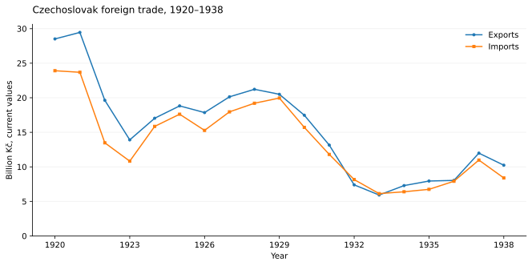
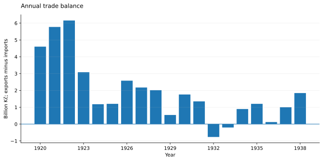
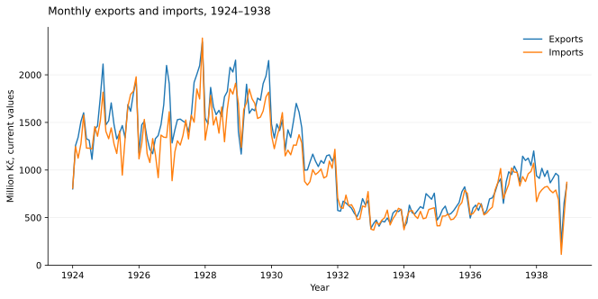
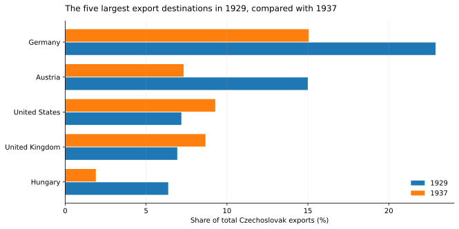

```{=html}
<div class="ac-page ds-page">
<p class="ac-back-link"><a href="data.html">← Datasets</a></p>
<h1>Czechoslovak foreign trade</h1>
<p class="ds-meta">Adam Dittrich · Annual: 1920–1938 · Monthly: January 1924–December 1938</p>
<p class="ds-lede">National exports, imports and trade balances, with annual bilateral trade for fifteen partners. The workbook also contains partner shares, year-on-year changes, export–import ratios and indices with 1929 as the reference year.</p>
<nav aria-label="On this page" class="ds-nav"><a href="#figures">Figures</a><a href="#coverage">Coverage and units</a><a href="#downloads">Downloads</a><a href="#citation">Citation</a></nav>
<div class="ds-facts"><div><strong>19 years</strong><span>Annual national and partner tables, 1920–1938.</span></div><div><strong>180 months</strong><span>National totals, January 1924–December 1938.</span></div><div><strong>15 partners</strong><span>285 annual partner observations; a selected sample, not the entire world.</span></div></div>
<section class="ds-section" id="figures"><h2>What the data show</h2>
<h3>Trade values contracted sharply after 1929</h3>
<p>Between 1929 and 1933, annual export values fell by <strong>71.1%</strong> and import values by <strong>69.3%</strong>. Exports recovered to 58.5% of their 1929 value by 1937. These are changes in <em>current-price trade values</em>, not estimates of changes in physical trade volumes.</p>
<figure class="ds-figure"><figcaption>Source: <em>Annual totals</em>. The chart divides the workbook’s million-Kč values by 1,000; no price adjustment is applied.<span class="ds-image-links"><a download="" href="assets/files/datasets/foreign-trade-annual.csv">Chart data (CSV)</a> · <a href="assets/files/datasets/figures/trade-annual.svg">Open figure</a> · <a href="assets/files/datasets/figures/trade-annual.png">PNG</a></span></figcaption></figure>
<h3>The balance turned negative in 1932 and 1933</h3>
<p>The annual series records deficits of <strong>766.0 million Kč in 1932</strong> and <strong>202.2 million Kč in 1933</strong>, followed by a surplus of <strong>896.0 million Kč in 1934</strong>. A surplus alone does not establish an export-led recovery: it can also reflect falling imports.</p>
<figure class="ds-figure"><figcaption>Source: <em>Annual totals</em>. Trade balance = exports − imports.<span class="ds-image-links"><a download="" href="assets/files/datasets/foreign-trade-annual.csv">Chart data (CSV)</a> · <a href="assets/files/datasets/figures/trade-balance.svg">Open figure</a> · <a href="assets/files/datasets/figures/trade-balance.png">PNG</a></span></figcaption></figure>
<h3>Monthly observations reveal movements hidden by annual totals</h3>
<p>The monthly table retains the supplied observations and their within-year variation. The chart applies no additional seasonal adjustment.</p>
<figure class="ds-figure"><figcaption>Source: <em>Monthly totals</em>. This is a separate released series; its yearly sums do not always equal the annual table.<span class="ds-image-links"><a download="" href="assets/files/datasets/foreign-trade-monthly.csv">Chart data (CSV)</a> · <a href="assets/files/datasets/figures/trade-monthly.svg">Open figure</a> · <a href="assets/files/datasets/figures/trade-monthly.png">PNG</a></span></figcaption></figure>
<div class="ds-note"><strong>Combining frequencies.</strong> Annual totals and monthly sums have not been reconciled. For example, 1932 imports are 8,157.914 million Kč in the annual table, against 7,461.300 million Kč when the supplied months are summed. The workbook does not document the reason for this difference. The annual comparisons above use the annual table. <a download="" href="assets/files/datasets/foreign-trade-frequency-check.csv">Download the annual–monthly comparison</a>.</div>
<h3>The distribution of exports changed</h3>
<p>Germany’s share of national exports declined from 22.89% in 1929 to 15.05% in 1937; Austria’s declined from 15.00% to 7.32%. The figure follows the five largest destinations in the supplied 1929 partner table, keeping the same selection in 1937.</p>
<figure class="ds-figure"><figcaption>Source: <em>Annual partners</em>. Shares use national exports as the denominator, not exports to the selected five countries.<span class="ds-image-links"><a download="" href="assets/files/datasets/foreign-trade-partners.csv">Chart data (CSV)</a> · <a href="assets/files/datasets/figures/trade-partners.svg">Open figure</a> · <a href="assets/files/datasets/figures/trade-partners.png">PNG</a></span></figcaption></figure>
<details><summary>View the complete annual national table</summary><div class="ds-table-scroll"><table class="ds-table"><caption>Annual national totals; million Kč at current values</caption><thead><tr><th scope="col">Year</th><th class="num" scope="col">Exports</th><th class="num" scope="col">Imports</th><th class="num" scope="col">Balance</th></tr></thead><tbody><tr><th scope="row">1920</th><td class="num">28,514.6</td><td class="num">23,912.3</td><td class="num">4,602.3</td></tr><tr><th scope="row">1921</th><td class="num">29,458.0</td><td class="num">23,685.4</td><td class="num">5,772.6</td></tr><tr><th scope="row">1922</th><td class="num">19,632.9</td><td class="num">13,477.6</td><td class="num">6,155.2</td></tr><tr><th scope="row">1923</th><td class="num">13,903.3</td><td class="num">10,820.9</td><td class="num">3,082.4</td></tr><tr><th scope="row">1924</th><td class="num">17,035.4</td><td class="num">15,854.7</td><td class="num">1,180.7</td></tr><tr><th scope="row">1925</th><td class="num">18,821.1</td><td class="num">17,618.1</td><td class="num">1,203.0</td></tr><tr><th scope="row">1926</th><td class="num">17,856.6</td><td class="num">15,276.7</td><td class="num">2,579.9</td></tr><tr><th scope="row">1927</th><td class="num">20,135.4</td><td class="num">17,961.6</td><td class="num">2,173.8</td></tr><tr><th scope="row">1928</th><td class="num">21,224.2</td><td class="num">19,207.9</td><td class="num">2,016.3</td></tr><tr><th scope="row">1929</th><td class="num">20,498.9</td><td class="num">19,957.9</td><td class="num">541.0</td></tr><tr><th scope="row">1930</th><td class="num">17,473.7</td><td class="num">15,714.5</td><td class="num">1,759.2</td></tr><tr><th scope="row">1931</th><td class="num">13,149.4</td><td class="num">11,800.5</td><td class="num">1,348.9</td></tr><tr><th scope="row">1932</th><td class="num">7,391.9</td><td class="num">8,157.9</td><td class="num">-766.0</td></tr><tr><th scope="row">1933</th><td class="num">5,923.0</td><td class="num">6,125.2</td><td class="num">-202.2</td></tr><tr><th scope="row">1934</th><td class="num">7,287.5</td><td class="num">6,391.6</td><td class="num">896.0</td></tr><tr><th scope="row">1935</th><td class="num">7,946.6</td><td class="num">6,743.2</td><td class="num">1,203.5</td></tr><tr><th scope="row">1936</th><td class="num">8,036.4</td><td class="num">7,915.2</td><td class="num">121.2</td></tr><tr><th scope="row">1937</th><td class="num">11,982.7</td><td class="num">10,981.5</td><td class="num">1,001.1</td></tr><tr><th scope="row">1938</th><td class="num">10,234.5</td><td class="num">8,390.4</td><td class="num">1,844.2</td></tr></tbody></table></div></details>
</section>
<section class="ds-section" id="coverage"><h2>Coverage and units</h2>
<div class="ds-table-scroll"><table class="ds-table"><thead><tr><th scope="col">Sheet</th><th scope="col">Observations</th><th scope="col">Contents</th></tr></thead><tbody><tr><td>Annual totals</td><td>19 years</td><td>National exports, imports, balance, turnover, export–import ratio, growth rates and 1929-based indices.</td></tr><tr><td>Annual partners</td><td>285 partner-years</td><td>Exports, imports, bilateral balances and shares of national trade for fifteen partners.</td></tr><tr><td>Monthly totals</td><td>180 months</td><td>National totals and derived indicators; no monthly bilateral panel is included.</td></tr><tr><td>Charts</td><td>Visual summaries</td><td>Workbook charts and their source tables.</td></tr></tbody></table></div>
<p>Trade values are stored in <strong>million current Kč</strong>. Balance is exports minus imports; turnover is their sum. Ratios, shares and growth columns are expressed as percentage numbers. Annual indices use the annual 1929 value; monthly indices use the mean month of 1929.</p>
<details><summary>Included partners</summary><p>Austria; Belgium and Luxembourg; France; Germany; Hungary; Italy; Netherlands; Poland; Romania; Sweden; Switzerland; USSR; United Kingdom; United States; Yugoslavia.</p><p>The partner table is not exhaustive. Its shares need not sum to 100%. It is distinct from the fourteen-partner basket used in the <a href="czechoslovakia-eer.html">EER dataset</a>.</p></details>
<p class="ds-small">All figures and descriptive calculations on this page use the supplied workbook. The workbook contains no separate source bibliography or explanation of the annual–monthly discrepancies; the page does not attribute those differences to rounding, revisions or any other unverified cause.</p>
</section>
<section class="ds-section ds-download" id="downloads"><h2>Download the data</h2><p>The Excel file is the author-supplied workbook, unchanged. The CSV files contain its stored data values without Excel formatting or formulas; dates use YYYY-MM-DD and missing values are blank.</p>
<div class="ds-download-links"><a download="" href="assets/files/datasets/Czechoslovak_Foreign_Trade_Interwar_Dataset.xlsx">Excel workbook</a><a download="" href="assets/files/datasets/foreign-trade-csv.zip">CSV tables (ZIP)</a></div>
<p class="ds-small"><a download="" href="assets/files/datasets/foreign-trade-annual.csv">Annual totals CSV</a> · <a download="" href="assets/files/datasets/foreign-trade-partners.csv">Annual partners CSV</a> · <a download="" href="assets/files/datasets/foreign-trade-monthly.csv">Monthly totals CSV</a></p></section>
<section class="ds-section" id="citation"><h2>Citation</h2><p>Dittrich, Adam. 2026. <em>Czechoslovak Foreign Trade: Interwar Dataset.</em> Excel reader edition supplied 22 October 2026. Personal academic website.</p><p><a download="" href="assets/files/datasets/dataset-citations.bib">Download dataset citations (BibTeX)</a></p></section>
</div>
```
