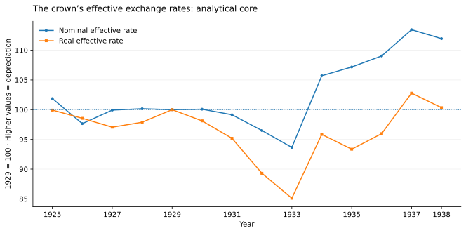
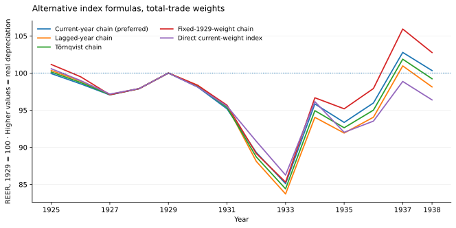
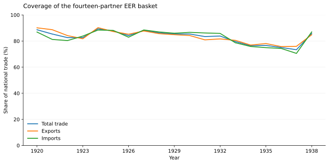

```{=html}
<div class="ac-page ds-page">
<p class="ac-back-link"><a href="data.html">← Datasets</a></p>
<h1>Czechoslovakia’s effective exchange rates</h1>
<p class="ds-meta">Adam Dittrich · Annual observations, 1920–1938 · 1929 = 100</p>
<p class="ds-lede">Companion data for <em>The Crown Against the World: Reconstructing Czechoslovakia’s Effective Exchange Rates, 1920–1938</em>, forthcoming in <em>Statistika: Statistics and Economy Journal</em>. The reader workbook provides nominal and CPI-based real indices, alternative weighting formulas, partner weights and basket coverage.</p>
<nav aria-label="On this page" class="ds-nav"><a href="#figures">Figures</a><a href="#methods">Methods</a><a href="#ljungberg">Ljungberg benchmark</a><a href="#downloads">Downloads and DOI</a></nav>
<div class="ds-facts"><div><strong>14 partners</strong><span>85.45% of national trade in the 1929 benchmark year.</span></div><div><strong>26 series</strong><span>Thirteen paired nominal and real specifications.</span></div><div><strong>Annual</strong><span>NEER: 1920–1938. REER: 1923–1938. Analytical core: 1925–1938.</span></div></div>
<div class="ds-note"><strong>Read the direction correctly:</strong> higher NEER means <strong>nominal depreciation</strong> of the crown; higher REER means <strong>real depreciation</strong> and stronger measured price competitiveness. The value 100 is the 1929 normalisation, not an estimate of an equilibrium exchange rate.</div>
<section class="ds-section" id="figures"><h2>What the data show</h2>
<p>The preferred real index falls from 100 in 1929 to <strong>85.11 in 1933</strong>. It rises to <strong>95.84 in 1934</strong>, a 12.61% increase over 1933, but remains below its 1929 benchmark. It reaches <strong>102.78 in 1937</strong>. The nominal and real paths therefore do not tell the same story throughout the decade.</p>
<figure class="ds-figure"><figcaption>Source: <em>Annual EER</em>, NEER_total and REER_total. Current-year-weighted geometric chains using exports plus imports. Higher values indicate depreciation.<span class="ds-image-links"><a download="" href="assets/files/datasets/eer-annual.csv">Chart data (CSV)</a> · <a href="assets/files/datasets/figures/eer-headline.svg">Open figure</a> · <a href="assets/files/datasets/figures/eer-headline.png">PNG</a></span></figcaption></figure>
<div class="ds-table-scroll"><table class="ds-table"><caption>Preferred total-trade-weighted chains, 1929 = 100</caption><thead><tr><th scope="col">Year</th><th class="num" scope="col">NEER</th><th class="num" scope="col">REER</th></tr></thead><tbody><tr><th scope="row">1929</th><td class="num">100.00</td><td class="num">100.00</td></tr><tr><th scope="row">1931</th><td class="num">99.14</td><td class="num">95.18</td></tr><tr><th scope="row">1933</th><td class="num">93.65</td><td class="num">85.11</td></tr><tr><th scope="row">1934</th><td class="num">105.71</td><td class="num">95.84</td></tr><tr><th scope="row">1936</th><td class="num">109.03</td><td class="num">95.97</td></tr><tr><th scope="row">1937</th><td class="num">113.45</td><td class="num">102.78</td></tr><tr><th scope="row">1938</th><td class="num">111.94</td><td class="num">100.33</td></tr></tbody></table></div>
<p class="ds-small">These are descriptive changes in annual indices. They do not identify the within-year timing or causal effect of a particular monetary-policy decision.</p>
<details><summary>Compare the alternative index formulas</summary><p>The workbook separates current-year, lagged-year, Törnqvist and fixed-1929-weight chains. A direct current-weighted index is also supplied for total trade; it is not a chained index.</p>
<figure class="ds-figure"><figcaption>Source: <em>All series</em>; trade_basis = TWEER and the five named method variants. All series are rebased to 1929 = 100.<span class="ds-image-links"><a download="" href="assets/files/datasets/eer-all-series.csv">Chart data (CSV)</a> · <a href="assets/files/datasets/figures/eer-methods.svg">Open figure</a> · <a href="assets/files/datasets/figures/eer-methods.png">PNG</a></span></figcaption></figure>
</details>
</section>
<section class="ds-section" id="methods"><h2>How the series are constructed</h2>
<p>The preferred series are <strong>current-year-weighted geometric chains</strong>. Let <em>e</em> be crowns per unit of harmonised foreign currency and <em>q = e × P<sub>foreign</sub> / P<sub>CS</sub></em> the corresponding bilateral real rate. The annual change of the effective index is the trade-weighted average of bilateral log changes:</p>
<div class="ds-equation"><code>ln I(t) − ln I(t−1) = Σᵢ w(i,t) [ln z(i,t) − ln z(i,t−1)]</code></div>
<p>Here <em>z = e</em> for NEER and <em>z = q</em> for REER. Chained levels are rebased to 1929 = 100. The workbook calls this the Paasche-type chain. Separate indices use total-trade, export and import weights; the six preferred series are on <em>Annual EER</em>, and all variants are on <em>All series</em>.</p>
<p>Weights sum to one <em>within the basket</em>. Coverage instead measures the basket’s share of all national trade. Total-trade coverage is 85.45% in 1929 and 73.37% in 1937; the chart retains the reported variation rather than implying a constant coverage rate.</p>
<figure class="ds-figure"><figcaption>Source: <em>Basket coverage</em>. Workbook proportions are multiplied by 100 for display. These are national coverage shares, not normalised partner weights.<span class="ds-image-links"><a download="" href="assets/files/datasets/eer-basket-coverage.csv">Chart data (CSV)</a> · <a href="assets/files/datasets/figures/eer-coverage.svg">Open figure</a> · <a href="assets/files/datasets/figures/eer-coverage.png">PNG</a></span></figcaption></figure>
<details><summary>Partners, early observations and missing values</summary><p>Austria; Belgium–Luxembourg; France; Germany; Hungary; Italy; Netherlands; Poland; Romania; Sweden; Switzerland; United Kingdom; United States; Yugoslavia.</p><p>The charts focus on 1925–1938, the workbook’s analytical core. The early extension is retained unchanged in the downloads: its exceptionally large values reflect the released treatment of currency units, partner hyperinflations and early price series. REER is unavailable in 1920–1922; those cells are blank, not zero, and have not been interpolated. No monthly EER series is included in this workbook.</p></details>
</section>
<section class="ds-section" id="ljungberg"><h2>Relation to Jonas Ljungberg’s database</h2>
<p><a href="https://www.lusem.lu.se/node/309">Ljungberg’s <em>Nominal and Real Effective Exchange Rates for Europe, 1870–2016</em></a> provides the broader European comparison. His <a href="https://portal.research.lu.se/en/publications/nominal-and-real-effective-exchange-rates-for-europe-1870-2016-so/">2019 methodological paper</a> explains the use of annual current-year trade weights, CPI adjustment and the depreciation-upward convention. This workbook implements geometric chains and supplies alternative formulas explicitly; it should not be treated as an identical copy of Ljungberg’s series.</p>
<div class="ds-table-scroll"><table class="ds-table ds-comparison"><caption>The Czechoslovak comparison</caption><thead><tr><th scope="col">Feature</th><th scope="col">Ljungberg’s interwar benchmark</th><th scope="col">This reader workbook</th></tr></thead><tbody><tr><th scope="row">Included partners</th><td>8 in Appendix A of the Cliometrica article</td><td>14</td></tr><tr><th scope="row">Share of national trade in 1929</th><td>69%</td><td>85.45%</td></tr><tr><th scope="row">Partner selection</th><td>Austria, Germany, Hungary, Poland, Romania, Soviet Union, United Kingdom and United States</td><td>The fourteen partners listed above; the Soviet Union is not in this basket</td></tr><tr><th scope="row">Index formula</th><td>The 2024 article’s Figure 1 uses Paasche fixed-base indices (note 20)</td><td>Preferred current-year-weighted geometric chains; alternative chains and a direct current-weighted variant are supplied</td></tr><tr><th scope="row">Where to find the comparison</th><td>European database and <em>Competitive devaluations in the 1930s: myth or reality?</em>, Appendix A</td><td><em>Annual EER</em>, <em>All series</em>, <em>Partner weights</em> and <em>Basket coverage</em></td></tr></tbody></table></div>
<p>The samples differ rather than forming a simple nested expansion. A comparison should match the reference year, direction, weighting formula and price coverage before interpreting differences between the indices.</p>
<p class="ds-reference">Ljungberg, Jonas. 2019. <em>Nominal and Real Effective Exchange Rates for Europe, 1870–2016: Some Methodological Issues.</em> Lund Papers in Economic History, 2019:200. <a href="https://portal.research.lu.se/en/publications/nominal-and-real-effective-exchange-rates-for-europe-1870-2016-so/">Publication record</a> · <a href="https://lup.lub.lu.se/search/files/66677473/LUPEH_200.pdf">Paper PDF</a> · <a href="https://www.lusem.lu.se/node/309">Database and download</a>.</p>
<p class="ds-reference">Ljungberg, Jonas. 2024. “Competitive devaluations in the 1930s: myth or reality?” <em>Cliometrica</em> 18, 151–189. Published online 18 December 2022. <a href="https://doi.org/10.1007/s11698-022-00262-9">doi:10.1007/s11698-022-00262-9</a>. Appendix A identifies the eight Czechoslovak partners and 69% coverage in 1929.</p>
</section>
<section class="ds-section ds-download" id="downloads"><h2>Download the data</h2><p>The Excel file preserves the supplied workbook, including full stored precision, definitions and internal charts. The CSV download contains four analysis-ready tables: annual indices, all specifications, partner weights and basket coverage.</p>
<div class="ds-download-links"><a download="" href="assets/files/datasets/Czechoslovakia_EER_1920_1938.xlsx">Excel workbook</a><a download="" href="assets/files/datasets/eer-csv.zip">CSV tables (ZIP)</a></div>
<p><a href="https://www.openicpsr.org/openicpsr/project/251023/version/V1/view">Related openICPSR replication deposit</a> · <a href="https://doi.org/10.3886/E251023V1"><strong>DOI: 10.3886/E251023V1</strong></a></p>
<p class="ds-small">The DOI is the related deposit cited in the workbook’s <em>Definitions</em> sheet (deposit date: 30 June 2026). This Excel download is the separately packaged reader edition dated 22 October 2026; it has not been assigned a new DOI, and is not presented as a byte-for-byte copy of the earlier deposit.</p>
</section>
<section class="ds-section" id="citation"><h2>Citation</h2><p>Dittrich, Adam. Forthcoming. “The Crown Against the World: Reconstructing Czechoslovakia’s Effective Exchange Rates, 1920–1938.” <em>Statistika: Statistics and Economy Journal.</em></p>
<p>For this file, also identify the <em>Czechoslovakia EER, 1920–1938</em> Excel reader edition, 22 October 2026. Cite the related replication deposit as <a href="https://doi.org/10.3886/E251023V1">doi:10.3886/E251023V1</a>.</p><p><a download="" href="assets/files/datasets/dataset-citations.bib">Dataset citations (BibTeX)</a> · <a download="" href="assets/files/datasets/related-literature.bib">Ljungberg references (BibTeX)</a> · <a href="publications.html#the-crown-against-the-world-reconstructing-czechoslovakias-effective-exchange-rates-19201938">Paper entry</a></p>
</section>
</div>
```
