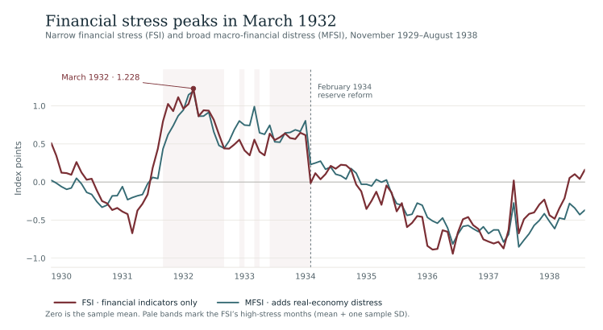
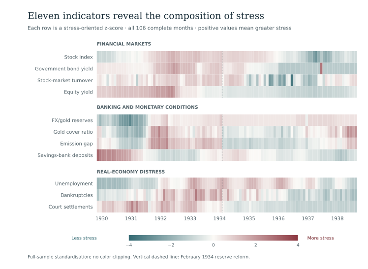
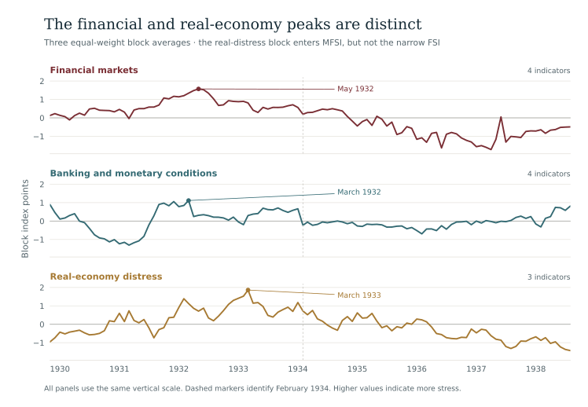
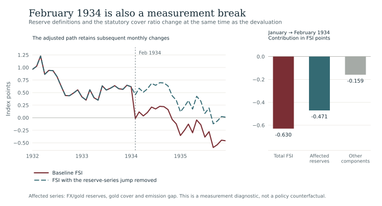
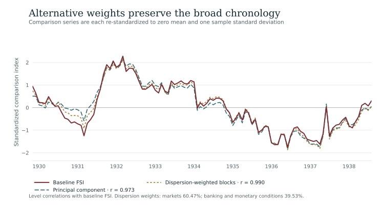
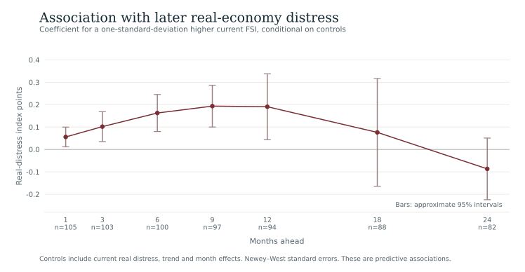
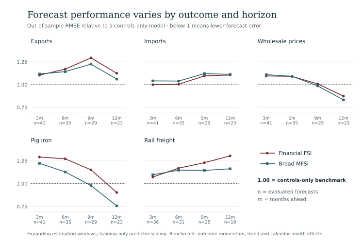

```{=html}
<main class="ac-page ds-page fsi-page" id="financial-stress-reader">
<p class="ac-back-link"><a href="data.html">← Datasets</a></p>
<p class="fsi-eyebrow">Research data · Interwar Czechoslovakia</p>
<h1>Financial stress in<br/> interwar Czechoslovakia</h1>
<p class="ds-meta">Adam Dittrich · Monthly · November 1929–August 1938</p>
<p class="fsi-intro">Financial pressure reached its maximum in <strong>March 1932</strong>. The real-economy distress block peaked a year later. This dataset reconstructs that sequence from market prices, central-bank reserves, savings-bank deposits, unemployment and business failures, giving a monthly view of the Czechoslovak Depression.</p>
<p class="ds-lede">Companion to <em>Measuring Financial Stress under the Gold Standard: Evidence from Interwar Czechoslovakia</em>, a research manuscript. The revised framework separates a financial-only index from a broader measure that also includes real distress, so the two sides of the Depression can be studied together.</p>
<div class="ds-download-links"><a class="fsi-download-primary" href="#downloads">Get the data</a><a href="https://www.openicpsr.org/openicpsr/project/247312/version/V1/view">openICPSR record · V1</a></div>
<p class="fsi-release"><strong>Edition:</strong> the figures and downloads here use the revised research files, packaged for readers on 23 October 2026. The linked DOI, <a href="https://doi.org/10.3886/E247312V1">10.3886/E247312V1</a>, identifies the earlier openICPSR V1 deposit. These local reader files are a separate edition; see <a href="#citation">version and citation details</a>.</p>
<div class="ds-facts"><div><strong>106 months</strong><span>A balanced sample from November 1929 to August 1938.</span></div><div><strong>8 + 3 inputs</strong><span>Eight financial indicators, with three real-distress indicators in the broader measure.</span></div><div><strong>22 months</strong><span>At or above the financial index’s mean + one standard deviation threshold.</span></div></div>
<nav aria-label="On this page" class="ds-nav"><a href="#overview">Overview</a><a href="#construction">Inside the indices</a><a href="#chronology">Chronology</a><a href="#reform-1934">February 1934</a><a href="#robustness">Robustness</a><a href="#later-activity">Later activity</a><a href="#downloads">Downloads</a></nav>
<p class="fsi-mobile-hint">Figures retain a readable size on small screens. Swipe horizontally within a figure, or open the full-size version below it.</p>

<section class="level2 ds-section" id="overview"><h2>Two measures of a prolonged crisis</h2>
<p>The narrow <strong>Financial Stress Index (FSI)</strong> follows conditions in financial markets and the banking and monetary system. The <strong>Macro-Financial Stress Index (MFSI)</strong> adds unemployment, bankruptcies and court-administered settlements. Both reach their overall maximum in March 1932; the real-distress component keeps the broader measure elevated into 1933.</p>
<figure class="ds-figure" id="figure-1">
<div class="fsi-chart-scroll" tabindex="0" role="region" aria-label="Figure 1. Financial-only FSI and broad MFSI, November 1929 to August 1938. Both peak in March 1932.. Scroll horizontally on small screens."></div>
<figcaption><strong>Figure 1.</strong> The financial-only and broad indices on their original index-point scales. The horizontal reference is zero; the vertical marker identifies the February 1934 institutional change. Pale shading marks months in which the FSI meets or exceeds its own sample mean plus one sample standard deviation. Averages of standardized inputs are not themselves standardized to unit variance.<span class="ds-image-links"><a href="assets/files/datasets/fsi/data/monthly_derived_indices_r.csv" download>Chart data (CSV)</a> · <a href="assets/files/datasets/fsi/figures/fsi-overview.svg">Open full-size figure</a> · <a href="assets/files/datasets/fsi/figures/fsi-overview.png" download>PNG</a></span></figcaption></figure>
<div class="ds-note"><strong>How to read the scale.</strong> Higher values mean greater stress relative to the historical sample. Zero is the sample average, and negative values indicate below-average stress. The indices average standardized inputs: a one-point change is <em>not</em> one standard deviation of the final composite. They are retrospective measures, not crisis probabilities.</div>
</section>

<section class="level2 ds-section" id="construction"><h2>What goes into the indices?</h2>
<p>The source material is principally the monthly <em>Reports of the National Bank of Czechoslovakia</em>. Eleven historical series are grouped into three blocks. Each input is first oriented so that higher values indicate more stress, then standardized using its mean and sample standard deviation over the common 106-month sample.</p>
<div class="fsi-measures"><div class="fsi-measure"><h3>Financial Stress Index · FSI</h3><p>Four market indicators and four banking and monetary indicators. The two blocks receive equal weight, so each of the eight inputs has a weight of 1/8.</p><p class="fsi-formula">FSI = (Market + Banking) / 2</p></div><div class="fsi-measure broad"><h3>Macro-Financial Stress Index · MFSI</h3><p>The same financial blocks plus a real-distress block. Each block receives one third of the weight: 1/12 per financial input and 1/9 per real-distress input.</p><p class="fsi-formula">MFSI = (Market + Banking + Real distress) / 3</p></div></div>
<p>This separation matters when studying the relationship between finance and subsequent economic weakness. Unemployment and business failures enter the MFSI; they are deliberately excluded from the financial-only FSI.</p>
<details id="indicator-guide"><summary>The eleven indicators, their units and stress directions</summary>
<div class="ds-table-scroll"><table class="ds-table fsi-components"><caption>Inputs to the revised indices</caption><thead><tr><th scope="col">Historical series</th><th scope="col">Stored raw unit</th><th scope="col">More stress when…</th></tr></thead><tbody>
<tr class="fsi-group"><th colspan="3" scope="rowgroup">Market block · FSI and MFSI</th></tr>
<tr><th scope="row">Prague Stock Exchange index<small><code>stock_index</code></small></th><td>Index, 3 January 1927 = 100</td><td>Lower</td></tr>
<tr><th scope="row">Government-security yield<small><code>bond_yield</code></small></th><td>Proportion</td><td>Higher</td></tr>
<tr><th scope="row">Exchange turnover<small><code>stock_turnover</code></small></th><td>Thousands of transactions</td><td>Lower</td></tr>
<tr><th scope="row">Average yield on quoted securities<small><code>equity_yield</code></small></th><td>Proportion</td><td>Higher</td></tr>
<tr class="fsi-group"><th colspan="3" scope="rowgroup">Banking and monetary block · FSI and MFSI</th></tr>
<tr><th scope="row">Eligible reserves<small><code>fx_reserves</code></small></th><td>Thousand Kč</td><td>Lower</td></tr>
<tr><th scope="row">Reserve / gold cover ratio<small><code>gold_cover</code></small></th><td>Proportion</td><td>Lower</td></tr>
<tr><th scope="row">Remaining legal note-issue capacity<small><code>emission_gap</code></small></th><td>Thousand Kč</td><td>Lower</td></tr>
<tr><th scope="row">Savings-bank deposits<small><code>deposits</code></small></th><td>Million Kč</td><td>Lower</td></tr>
<tr class="fsi-group"><th colspan="3" scope="rowgroup">Real-distress block · MFSI only</th></tr>
<tr><th scope="row">Registered unemployed job seekers<small><code>unemployment</code></small></th><td>Persons</td><td>Higher</td></tr>
<tr><th scope="row">Declared bankruptcies<small><code>bankruptcies</code></small></th><td>Monthly count</td><td>Higher</td></tr>
<tr><th scope="row">Court-administered settlements<small><code>settlements</code></small></th><td>Monthly count</td><td>Higher</td></tr>
</tbody></table></div>
<p class="ds-small">Turnover counts transactions; it is not a monetary trading volume. Deposits refer to savings banks, not all bank deposits. The historical quoted-security yield retains the code name <code>equity_yield</code>. The three reserve-related series require special care around February 1934. Stored proportions are not silently converted into percentages in the downloads.</p>
<p><a href="assets/files/datasets/fsi/data/data_dictionary.csv" download>Download the full data dictionary</a></p>
</details>
<details><summary>See how the individual components move</summary>
<p>The heatmap shows stress-oriented standardized inputs. It reveals which pressures were shared across domains and which persisted after the main financial peak. Each row is measured against that indicator’s own historical mean and standard deviation.</p>
<figure class="ds-figure" id="figure-2">
<div class="fsi-chart-scroll" tabindex="0" role="region" aria-label="Figure 2. Eleven stress-oriented indicators grouped into market, banking and monetary, and real-distress blocks.. Scroll horizontally on small screens."></div>
<figcaption><strong>Figure 2.</strong> Component-level stress. Colors show each input’s stress-oriented z score; higher values mean greater relative stress. Color limits and any saturation are identified in the graphic.<span class="ds-image-links"><a href="assets/files/datasets/fsi/data/monthly_derived_indices_r.csv" download>Chart data (CSV)</a> · <a href="assets/files/datasets/fsi/figures/fsi-components.svg">Open full-size figure</a> · <a href="assets/files/datasets/fsi/figures/fsi-components.png" download>PNG</a></span></figcaption></figure>
</details>
<p class="fsi-source">Source: revised manuscript, construction section and indicator documentation; <a href="assets/files/datasets/fsi/data/data_dictionary.csv">data dictionary</a>. Original report and page locators are documented in the manuscript’s data-provenance appendix.</p>
</section>

<section class="level2 ds-section" id="chronology"><h2>Financial pressure in 1932, real distress in 1933</h2>
<p>The financial series intensify during the regional and gold-standard crises of 1931. The banking and monetary block peaks in <strong>March 1932</strong>, followed by the market block in <strong>May 1932</strong>. The real-distress block reaches its maximum in <strong>March 1933</strong>. Monthly observations make this staggered sequence visible.</p>
<figure class="ds-figure" id="figure-3">
<div class="fsi-chart-scroll" tabindex="0" role="region" aria-label="Figure 3. Market, banking and monetary, and real-distress blocks. Financial blocks peak in 1932; real distress peaks in March 1933.. Scroll horizontally on small screens."></div>
<figcaption><strong>Figure 3.</strong> Three blocks, each constructed as the mean of its stress-oriented standardized inputs. The financial-only FSI uses the first two; the MFSI uses all three. Peaks in different blocks need not coincide.<span class="ds-image-links"><a href="assets/files/datasets/fsi/data/monthly_derived_indices_r.csv" download>Chart data (CSV)</a> · <a href="assets/files/datasets/fsi/figures/fsi-sector-sequence.svg">Open full-size figure</a> · <a href="assets/files/datasets/fsi/figures/fsi-sector-sequence.png" download>PNG</a></span></figcaption></figure>
<h3>Dating high-stress episodes</h3>
<p>The baseline rule marks months when an index exceeds its own sample mean by at least one of its own standard deviations. For the FSI, the cutoff is <strong>0.539 index points</strong>. It identifies four episodes and 22 months in total. These are reproducible statistical dates, not a catalogue of bank failures.</p>
<div class="ds-table-scroll"><table class="ds-table"><caption>Financial-only FSI · mean + 1 SD threshold</caption><thead><tr><th scope="col">High-stress interval</th><th scope="col" class="num">Months</th><th scope="col">Peak month</th><th scope="col" class="num">Peak FSI</th></tr></thead><tbody><tr><th scope="row">September 1931–August 1932</th><td class="num">12</td><td>March 1932</td><td class="num">1.228</td></tr>
<tr><th scope="row">December 1932</th><td class="num">1</td><td>December 1932</td><td class="num">0.555</td></tr>
<tr><th scope="row">March 1933</th><td class="num">1</td><td>March 1933</td><td class="num">0.556</td></tr>
<tr><th scope="row">June 1933–January 1934</th><td class="num">8</td><td>December 1933</td><td class="num">0.647</td></tr></tbody></table></div>
<p class="fsi-source">Source: <a href="assets/files/datasets/fsi/data/table_crisis_episodes.csv" download>episode table (CSV)</a>. Peak values are in index points.</p>
<details><summary>Compare the broader macro-financial episodes</summary><p>The MFSI’s own mean + 1 SD cutoff is 0.526 index points. It identifies 25 months in three episodes, reflecting the persistence of unemployment and business distress.</p>
<div class="ds-table-scroll"><table class="ds-table"><caption>Broad MFSI · mean + 1 SD threshold</caption><thead><tr><th scope="col">High-stress interval</th><th scope="col" class="num">Months</th><th scope="col">Peak month</th><th scope="col" class="num">Peak MFSI</th></tr></thead><tbody><tr><th scope="row">October 1931–July 1932</th><td class="num">10</td><td>March 1932</td><td class="num">1.193</td></tr>
<tr><th scope="row">October 1932–July 1933</th><td class="num">10</td><td>March 1933</td><td class="num">0.990</td></tr>
<tr><th scope="row">September 1933–January 1934</th><td class="num">5</td><td>January 1934</td><td class="num">0.804</td></tr></tbody></table></div></details>
</section>

<section class="level2 ds-section" id="reform-1934"><h2>Why February 1934 needs a closer look</h2>
<p>The measured FSI drops by <strong>0.630 index points</strong> from January to February 1934. At the same time, devaluation and monetary reform alter the reserve framework: the statutory cover requirement falls from 30% to 25%, and the eligible-reserve concept changes from gold plus qualifying foreign exchange to gold only.</p>
<p>The reserve, cover-ratio and note-issue-capacity components account for <strong>74.8%</strong> of that one-month FSI decline. This is an arithmetic decomposition. It combines a change in measurement with genuine relief of the legal constraint on note issue; it does not identify the causal effect of devaluation on the economy.</p>
<figure class="ds-figure" id="figure-4">
<div class="fsi-chart-scroll" tabindex="0" role="region" aria-label="Figure 4. Baseline FSI and February 1934 break-neutralized FSI, showing the contribution of the institutional change.. Scroll horizontally on small screens."></div>
<figcaption><strong>Figure 4.</strong> The baseline and break-neutralized financial indices, shown on the same index-point scale. The adjustment removes the immediate jump in the three reserve-related inputs and retains later changes; it is a diagnostic, not a causal counterfactual.<span class="ds-image-links"><a href="assets/files/datasets/fsi/data/monthly_derived_indices_r.csv" download>Chart data (CSV)</a> · <a href="assets/files/datasets/fsi/figures/fsi-1934-break.svg">Open full-size figure</a> · <a href="assets/files/datasets/fsi/figures/fsi-1934-break.png" download>PNG</a></span></figcaption></figure>
<p>A diagnostic series removes the immediate January–February jump in the three affected standardized inputs from February 1934 onward, while retaining their later movements. On this basis, the average financial-only index changes little across the surrounding twelve-month windows. The broader index still declines as real distress eases.</p>
<div class="ds-table-scroll"><table class="ds-table"><caption>Break-neutralized averages around the reform</caption><thead><tr><th scope="col">Index</th><th scope="col" class="num">Feb 1933–Jan 1934</th><th scope="col" class="num">Feb 1934–Jan 1935</th></tr></thead><tbody><tr><th scope="row">Financial-only FSI</th><td class="num">0.539</td><td class="num">0.531</td></tr><tr><th scope="row">Broad MFSI</th><td class="num">0.687</td><td class="num">0.445</td></tr></tbody></table></div>
<p class="ds-small">The adjustment removes the immediate legal relief as well as the reporting break. It is a conservative sensitivity check, not an estimated path for a Czechoslovakia without devaluation.</p>
<p class="fsi-source">Sources: <a href="assets/files/datasets/fsi/data/table_1934_break_summary.csv" download>break summary</a> and <a href="assets/files/datasets/fsi/data/table_1934_break_decomposition.csv" download>component decomposition</a>.</p>
</section>

<section class="level2 ds-section" id="robustness"><h2>How much depends on construction?</h2>
<p class="fsi-key-result">The concentration of financial pressure in late 1931–1932 survives the main alternative constructions. Its exact height and peak month are more sensitive.</p>
<p>Principal-component and dispersion-weighted alternatives correlate <strong>0.973</strong> and <strong>0.990</strong> with the baseline FSI; both peak in March 1932. Using earlier historical reference periods moves the maximum to May or June 1932. Omitting one financial input at a time produces correlations of <strong>0.949–0.991</strong>; seven of the eight variants retain the March 1932 peak.</p>
<details><summary>Compare the alternative constructions and reference periods</summary>
<figure class="ds-figure" id="figure-5">
<div class="fsi-chart-scroll" tabindex="0" role="region" aria-label="Figure 5. Baseline, principal-component and dispersion-weighted financial-stress indices.. Scroll horizontally on small screens."></div>
<figcaption><strong>Figure 5.</strong> Baseline, principal-component and dispersion-weighted indices, each standardized to mean zero and sample standard deviation one for visual comparison. The table below additionally reports historical-reference standardizations and the February 1934 diagnostic.<span class="ds-image-links"><a href="assets/files/datasets/fsi/data/monthly_robustness_series.csv" download>Chart data (CSV)</a> · <a href="assets/files/datasets/fsi/figures/fsi-robustness.svg">Open full-size figure</a> · <a href="assets/files/datasets/fsi/figures/fsi-robustness.png" download>PNG</a></span></figcaption></figure>
<div class="ds-table-scroll"><table class="ds-table"><caption>Alternative FSI constructions</caption><thead><tr><th scope="col">Specification</th><th scope="col" class="num">Correlation with baseline</th><th scope="col">Peak month</th></tr></thead><tbody><tr><th scope="row">Principal component (PCA)</th><td class="num">0.973</td><td>March 1932</td></tr>
<tr><th scope="row">Dispersion-weighted blocks</th><td class="num">0.990</td><td>March 1932</td></tr>
<tr><th scope="row">Median / median absolute deviation</th><td class="num">0.792</td><td>March 1932</td></tr>
<tr><th scope="row">November 1929–April 1931 reference</th><td class="num">0.899</td><td>May 1932</td></tr>
<tr><th scope="row">January 1927–October 1929 reference (six inputs)</th><td class="num">0.873</td><td>June 1932</td></tr>
<tr><th scope="row">February 1934 break-neutralized FSI</th><td class="num">0.907</td><td>March 1932</td></tr></tbody></table></div>
<p class="ds-small">The pre-1929 benchmark uses six inputs with available earlier observations, so it also changes coverage. The leave-one-out variant excluding reserves peaks in December 1931. Comparisons therefore support a common episode more strongly than a single immutable turning month.</p>
<p class="fsi-source">Sources: <a href="assets/files/datasets/fsi/data/table_robustness_correlations.csv" download>robustness correlations</a> and <a href="assets/files/datasets/fsi/data/table_leave_one_out.csv" download>leave-one-out results</a>.</p>
</details>
<details><summary>How the high-stress count changes with the cutoff</summary><p>A stricter cutoff shortens the marked crisis. The standard deviation here is calculated separately for each final index. These thresholds are descriptive choices; they do not estimate a probability of crisis.</p>
<div class="ds-table-scroll"><table class="ds-table"><caption>Number of months meeting each threshold</caption><thead><tr><th scope="col">Threshold</th><th scope="col" class="num">FSI months</th><th scope="col" class="num">MFSI months</th></tr></thead><tbody><tr><th scope="row">Mean + 0.75 SD</th><td class="num">28</td><td class="num">29</td></tr>
<tr><th scope="row">Mean + 1 SD</th><td class="num">22</td><td class="num">25</td></tr>
<tr><th scope="row">Mean + 1.25 SD</th><td class="num">11</td><td class="num">18</td></tr>
<tr><th scope="row">Mean + 1.5 SD</th><td class="num">10</td><td class="num">10</td></tr>
<tr><th scope="row">Mean + 2 SD</th><td class="num">2</td><td class="num">2</td></tr></tbody></table></div><p class="fsi-source">Source: <a href="assets/files/datasets/fsi/data/table_threshold_sensitivity.csv" download>threshold sensitivity (CSV)</a>.</p></details>
</section>

<section class="level2 ds-section" id="later-activity"><h2>What does financial stress say about later activity?</h2>
<p>Higher current FSI is associated with greater subsequent real distress at horizons up to twelve months, after controlling for current real distress, a time trend and calendar-month effects. The estimated relationship is no longer statistically distinguishable from zero at eighteen and twenty-four months. This is evidence of a temporal association within the sample, not a causal estimate.</p>
<figure class="ds-figure" id="figure-6">
<div class="fsi-chart-scroll" tabindex="0" role="region" aria-label="Figure 6. Estimated relationship between current financial stress and future real distress at horizons from one to twenty-four months, with 95 percent confidence intervals.. Scroll horizontally on small screens."></div>
<figcaption><strong>Figure 6.</strong> Estimated change in future real-distress index points associated with a one-standard-deviation increase in current FSI, conditional on current real distress, a trend and calendar-month effects. Approximate 95% intervals use 1.96 times the HAC/Newey–West standard errors. Here the explanatory FSI is standardized for the regression, unlike the plotted baseline level in Figure 1.<span class="ds-image-links"><a href="assets/files/datasets/fsi/data/table_real_distress_horizons.csv" download>Chart data (CSV)</a> · <a href="assets/files/datasets/fsi/figures/fsi-future-distress.svg">Open full-size figure</a> · <a href="assets/files/datasets/fsi/figures/fsi-future-distress.png" download>PNG</a></span></figcaption></figure>
<details><summary>Forecasting performance: selected indicators can be more useful than the composite</summary>
<p>The study also compares expanding-window forecasts for exports, imports, wholesale prices, pig-iron production and rail freight at horizons of 3, 6, 9 and 12 months. These are twenty outcome–horizon comparisons against a controls-only baseline that includes the outcome’s current twelve-month change, a linear trend and calendar-month effects.</p>
<figure class="ds-figure" id="figure-7">
<div class="fsi-chart-scroll" tabindex="0" role="region" aria-label="Figure 7. Forecast-error comparisons against the controls-only baseline, with the benchmark at a ratio of one.. Scroll horizontally on small screens."></div>
<figcaption><strong>Figure 7.</strong> Out-of-sample forecast error relative to the controls-only baseline. Values below one improve on the baseline; values above one have larger errors. The figure reports the comparison and sample-size conventions. See the full forecast table for each outcome and horizon.<span class="ds-image-links"><a href="assets/files/datasets/fsi/data/table_predictive_oos_external.csv" download>Chart data (CSV)</a> · <a href="assets/files/datasets/fsi/figures/fsi-forecast-comparison.svg">Open full-size figure</a> · <a href="assets/files/datasets/fsi/figures/fsi-forecast-comparison.png" download>PNG</a></span></figcaption></figure>
<p>The financial-only FSI increases average forecast RMSE by <strong>11.8%</strong>; the broader MFSI increases it by <strong>7.6%</strong>. In contrast, the quoted-security yield and savings-bank deposits reduce average RMSE by <strong>15.4%</strong> and <strong>14.5%</strong>. The composite captures the breadth and chronology of stress, while individual indicators can retain more useful predictive information for particular outcomes.</p>
<p class="ds-small">Forecast origins begin in 1935. Each outcome–horizon cell has 19–41 forecasts, with fewer observations for rail freight. This exercise does not test prediction of the 1931 crisis onset. Percentage results are unweighted averages across the twenty cells, not a pooled error statistic.</p>
<p class="fsi-source">Sources: <a href="assets/files/datasets/fsi/data/table_predictive_oos_external.csv" download>full forecast comparisons</a> and <a href="assets/files/datasets/fsi/data/table_predictive_oos_external_summary.csv" download>forecast summary</a>.</p>
</details>
</section>

<section class="level2 ds-section ds-download" id="downloads"><h2>Download and work with the data</h2>
<p>The compact monthly file contains the FSI, MFSI and the three underlying blocks for all 106 complete months. The reader bundle adds raw observations, the full derived series, robustness variants, result tables, a data dictionary and the script used to draw the figures on this page.</p>
<div class="ds-download-links"><a class="fsi-download-primary" href="assets/files/datasets/fsi/monthly-indices.csv" download>Monthly indices · CSV</a><a href="assets/files/datasets/fsi/fsi-reader-data.zip" download>Reader data and figure code · ZIP</a><a href="https://www.openicpsr.org/openicpsr/project/247312/version/V1/view">Original archive · openICPSR V1</a></div>
<ul class="fsi-data-list"><li><strong>Choose the measure for the question.</strong> Use the FSI for financial conditions and the MFSI for broader macro-financial distress. Keep the component blocks when the timing across markets, monetary conditions and the real economy matters.</li><li><strong>Keep the sample boundary explicit.</strong> Several raw series begin in January 1927 or continue to September 1938. The complete indices run from November 1929 through August 1938. Missing September deposits and real-distress observations are not interpolated into a final composite.</li><li><strong>Treat February 1934 as an institutional break.</strong> Use the diagnostic variants to check how conclusions depend on reserve definitions and the change in statutory cover.</li><li><strong>Distinguish inputs from outcomes.</strong> Exports, imports, wholesale prices, pig-iron output and rail freight are downstream outcomes, not index components. The discount rate is a policy diagnostic. The undocumented <code>stavka_unused</code> series is retained in the raw file but excluded from analysis.</li><li><strong>Retain the edition information.</strong> This reader edition reflects the revised research package. The older deposit has its own version-specific citation and should not be treated as an identical copy.</li></ul>
<p><a href="assets/files/datasets/fsi/README.txt">File guide and reproduction instructions</a> · <a href="assets/files/datasets/fsi/data/data_dictionary.csv" download>Data dictionary</a> · <a href="assets/files/datasets/fsi/build_fsi_figures.py" download>Figure script</a></p>
</section>

<section class="level2 ds-section" id="citation"><h2>Versions, provenance and citation</h2>
<p><strong>Research manuscript.</strong> Dittrich, Adam. <em>Measuring Financial Stress under the Gold Standard: Evidence from Interwar Czechoslovakia.</em> Revised research manuscript. The figures and numerical results above follow the consolidated revised research files.</p>
<p><strong>Original archived dataset.</strong> Dittrich, Adam. 2026. <em>Measuring Financial Stress under the Gold Standard: Evidence from Interwar Czechoslovakia.</em> Ann Arbor, MI: Inter-university Consortium for Political and Social Research [distributor], 7 April 2026. Version 1. <a href="https://doi.org/10.3886/E247312V1">doi:10.3886/E247312V1</a>.</p>
<p><strong>This reader edition.</strong> Dittrich, Adam. 2026. <em>Financial stress in interwar Czechoslovakia, 1929–1938: revised reader data and figures.</em> 23 October 2026. Identify this edition and the local file used when citing these revised series. It has not been assigned a separate DOI, and the V1 DOI does not identify these revised files.</p>
<p>The revised research package was prepared for a further openICPSR release. Readers should use the exact version-specific record associated with the archive they download. The public V1 citation remains available here for the original deposited material.</p>
<p><a href="assets/files/datasets/fsi/citations.bib" download>Citations · BibTeX</a> · <a href="publications.html#measuring-financial-stress-under-the-gold-standard-evidence-from-interwar-czechoslovakia">Paper entry</a> · <a href="research.html#financial-stress-and-banking">Research context</a></p>
<h3>Related Czechoslovak datasets</h3><p>The trade and effective-exchange-rate datasets provide complementary series for studying external adjustment during the same period.</p><div class="fsi-related"><a href="czechoslovak-foreign-trade.html">Foreign trade: data and figures →</a><a href="czechoslovakia-eer.html">Effective exchange rates: data and figures →</a></div>
<p class="fsi-top-link"><a href="#financial-stress-reader">Back to top ↑</a></p>
</section>
</main>

```
