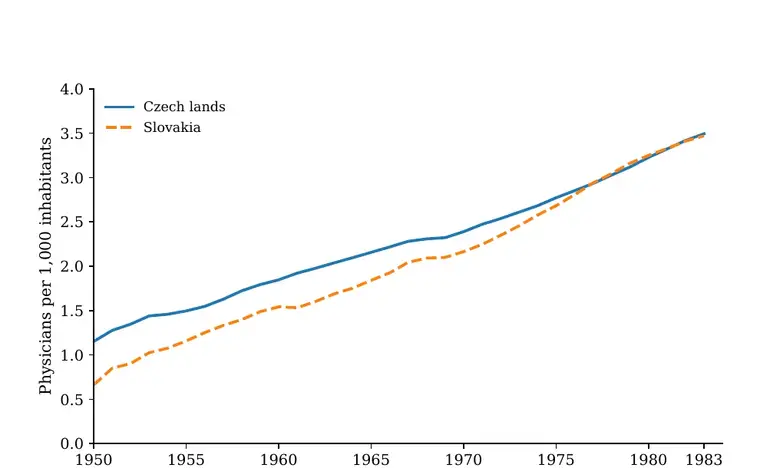
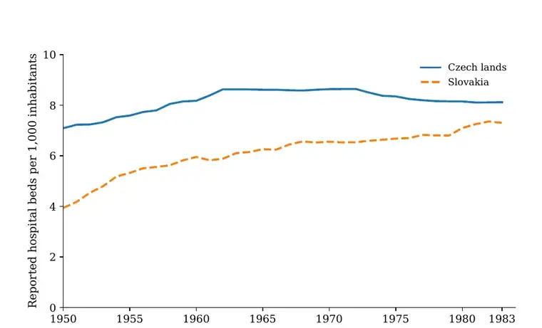
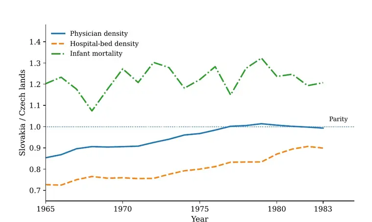
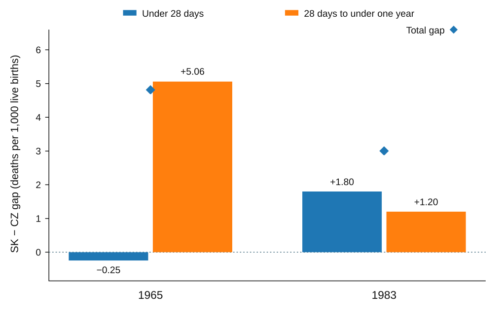
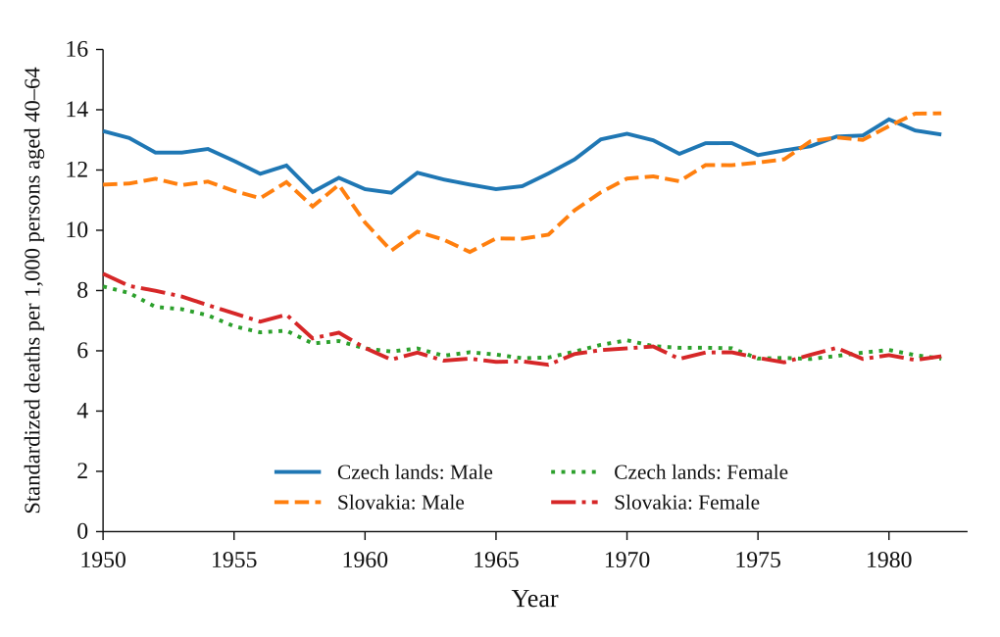
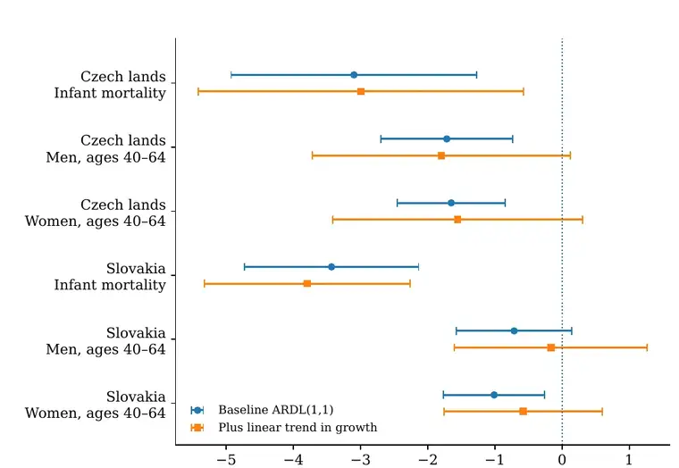

```{=html}
<div class="ac-page ac-project-page">
<p class="ac-back-link"><a href="publications.html#conference-presentations">← Conference presentations</a></p>

<header class="ac-project-header">
<p class="ac-kicker">Preliminary conference results · work in progress</p>
<h1>More Doctors, Unequal Survival</h1>
<p class="ac-project-subtitle">Healthcare Capacity in Socialist Czechoslovakia, 1950–1983</p>
<p class="ac-project-authors"><strong>Adam Dittrich, Jiří Rytina, and Jakub Drábek</strong></p>
<p class="ac-project-meta">Presented as <em>Kapacita bez efektivity? Zdravotnická infrastruktura a zdravotní výsledky v socialistickém Československu</em> [Capacity without Effectiveness? Healthcare Infrastructure and Health Outcomes in Socialist Czechoslovakia], České Budějovice, 16 October 2026.</p>
<p class="ac-project-lede">The project asks whether the large post-war expansion and territorial equalisation of healthcare provision was matched by comparable convergence in survival. The answer is not a simple success-or-failure verdict. Capacity expanded substantially and infant survival improved, but outcomes diverged by republic, age and sex.</p>
<p><a class="pill-link" href="https://www.zsf.jcu.cz/images/ZSF/veda-a-vyzkum/konference/zdravi_a_socialni_otazky/CONFERENCE_Zdravi_program_26-10-14_final_version.pdf#page=4">Conference programme · p. 4</a> <a class="pill-link" href="https://www.zsf.jcu.cz/cz/veda-a-vyzkum/konference/zdravi-a-socialni-otazky-v-dejinach-interdisciplinarni-perspektivy">Conference page</a></p>
</header>

<section class="ac-section">
<h2>Question and argument</h2>
<p>Official Czechoslovak statistics treated rising numbers of physicians and hospital beds as evidence of a high level of healthcare. The same statistical source also recorded mortality stagnation. We therefore distinguish the <strong>physical capacity of the system</strong> from the <strong>survival outcomes of the populations it served</strong>.</p>
<p>We describe the observed pattern as <strong>selective effectiveness</strong>: major expansion and regional equalisation of provision, substantial gains in infant survival, a persistent Czech–Slovak infant-mortality difference, and deteriorating survival among middle-aged men. This is not an argument that capacity had no value. It is an argument that aggregate staffing and bed counts cannot stand in for the specialisation, distribution and quality of care, or for its fit with changing health needs.</p>
</section>

<section class="ac-section">
<h2>Central results</h2>
<div class="ac-stat-grid">
  <div class="ac-stat"><strong>57.5 → 99.3%</strong><span>Slovak physician density relative to the Czech level, 1950–1983</span></div>
  <div class="ac-stat"><strong>55.6 → 89.9%</strong><span>Slovak hospital-bed density relative to the Czech level, 1950–1983</span></div>
  <div class="ac-stat"><strong>≈ −39%</strong><span>Infant mortality in both republics, 1965–1983</span></div>
  <div class="ac-stat"><strong>+15.9 / +42.7%</strong><span>Male mortality at ages 40–64, Czech lands / Slovakia, 1965–1982</span></div>
</div>
</section>

<section class="ac-section">
<h2>Evidence and method</h2>
<p>The evidence is an annual Czech–Slovak panel assembled from the <em>Historical Statistical Yearbook of Czechoslovakia</em>. Capacity series cover 1950–1983 and include physicians, hospital beds and hospital activity. Outcomes include infant mortality, neonatal and postneonatal deaths, age- and sex-specific mortality, and life-table measures.</p>
<ul class="ac-method-list">
<li><strong>Capacity:</strong> physicians and reported hospital beds per 1,000 inhabitants, combined in a common-anchor index.</li>
<li><strong>Infant survival:</strong> comparisons begin in 1965 to remain within the later live-birth registration regime; infant deaths are decomposed into the first 28 days and the remainder of the first year.</li>
<li><strong>Adult survival:</strong> fixed-weight mortality rates for ages 40–64 prevent changing age composition from generating the result.</li>
<li><strong>Annual relationships:</strong> short-lag ARDL models in log changes examine conditional capacity–mortality associations. They do not identify a causal treatment effect or the number of lives saved by an additional physician.</li>
</ul>
</section>

<section class="ac-section ac-findings">
<h2>Main findings</h2>

<h3>1. Medical provision converged strongly</h3>
<p>Slovakia moved from a large initial deficit to near parity in physician density. Hospital-bed density also converged, although less completely. The composition of expansion differed: after 1965, Czech growth was primarily a staffing story, while Slovakia continued to expand both physicians and beds.</p>
<div class="ac-figure-grid">
<figure class="ac-research-figure">

<figcaption>Physician density: the initial Slovak deficit had almost closed by 1983.</figcaption>
</figure>
<figure class="ac-research-figure">

<figcaption>Hospital beds: a Czech plateau and continued Slovak catch-up.</figcaption>
</figure>
</div>

<h3>2. Infant survival improved, but the relative regional gap persisted</h3>
<p>Between 1965 and 1983, infant mortality fell from 23.7 to 14.5 deaths per 1,000 live births in the Czech lands and from 28.5 to 17.5 in Slovakia. The decline was approximately 39% in both republics. The absolute difference narrowed, but Slovakia’s rate remained about one fifth higher.</p>
<figure class="ac-research-figure ac-figure-wide">

<figcaption>Input deficits closed while the relative infant-mortality disadvantage remained close to 20%.</figcaption>
</figure>

<h3>3. The same total gap concealed a different age-specific problem</h3>
<p>In 1965, Czech and Slovak neonatal mortality was nearly equal and Slovakia’s disadvantage was concentrated after the first 28 days. By 1983, 60% of the remaining absolute gap was located in the neonatal period. The relative total changed little, but the stage of infancy requiring explanation changed substantially.</p>
<figure class="ac-research-figure ac-figure-wide">

<figcaption>The postneonatal gap narrowed sharply; the first 28 days became the main component of the remaining difference.</figcaption>
</figure>

<h3>4. Middle-aged male survival deteriorated inside the expanding system</h3>
<p>Fixed-weight male mortality at ages 40–64 rose by 15.9% in the Czech lands and 42.7% in Slovakia between 1965 and 1982. The adverse direction is not an ageing artefact: every constituent male age-specific rate increased in both republics in the 1960–1982 comparison. Remaining life expectancy at age 40 also fell, by 1.93 years in the Czech lands and 2.53 years in Slovakia between 1960 and 1983.</p>
<figure class="ac-research-figure ac-figure-wide">

<figcaption>Infant gains coexisted with a pronounced deterioration in middle-aged male survival.</figcaption>
</figure>

<h3>5. Annual models are most informative for infant mortality</h3>
<p>In the baseline models, stronger current and lagged capacity growth was associated with more favourable infant-mortality change in both republics. These infant associations remain negative after adding a trend in mortality growth. Adult point estimates are generally negative, but become imprecise in the more flexible specification. The models therefore complement the historical contrasts; they do not turn them into causal estimates.</p>
<figure class="ac-research-figure ac-figure-wide">

<figcaption>Capacity-growth associations are most stable for infant mortality; adult estimates are more specification-sensitive.</figcaption>
</figure>
</section>

<section class="ac-section">
<h2>Interpretation</h2>
<p>The Czechoslovak case separates two processes that are often conflated in histories of the welfare state: equalising the territorial supply of healthcare and equalising health outcomes. The first advanced substantially. The second depended on the population and stage of life being considered.</p>
<p>The evidence directs attention beyond aggregate capacity to specialist services, equipment, referral systems, health risks and the implementation of medical knowledge. Near-equality in physicians per inhabitant did not necessarily mean equal obstetric or neonatal capacity relative to births, nor equal ability to address the causes of rising male mortality.</p>
</section>

<section class="ac-section">
<h2>Next steps</h2>
<p>The next stage of the project is to connect republic-level outcomes to more specific mechanisms: harmonised cause-of-death series for adults; birthweight, gestational-age and perinatal-care evidence for infants; the district distribution and specialisation of services; and archival records of planning, equipment and referral decisions.</p>
<p class="ac-project-status"><strong>Status:</strong> preliminary results presented at the conference; working paper in preparation.</p>
</section>
</div>
```
