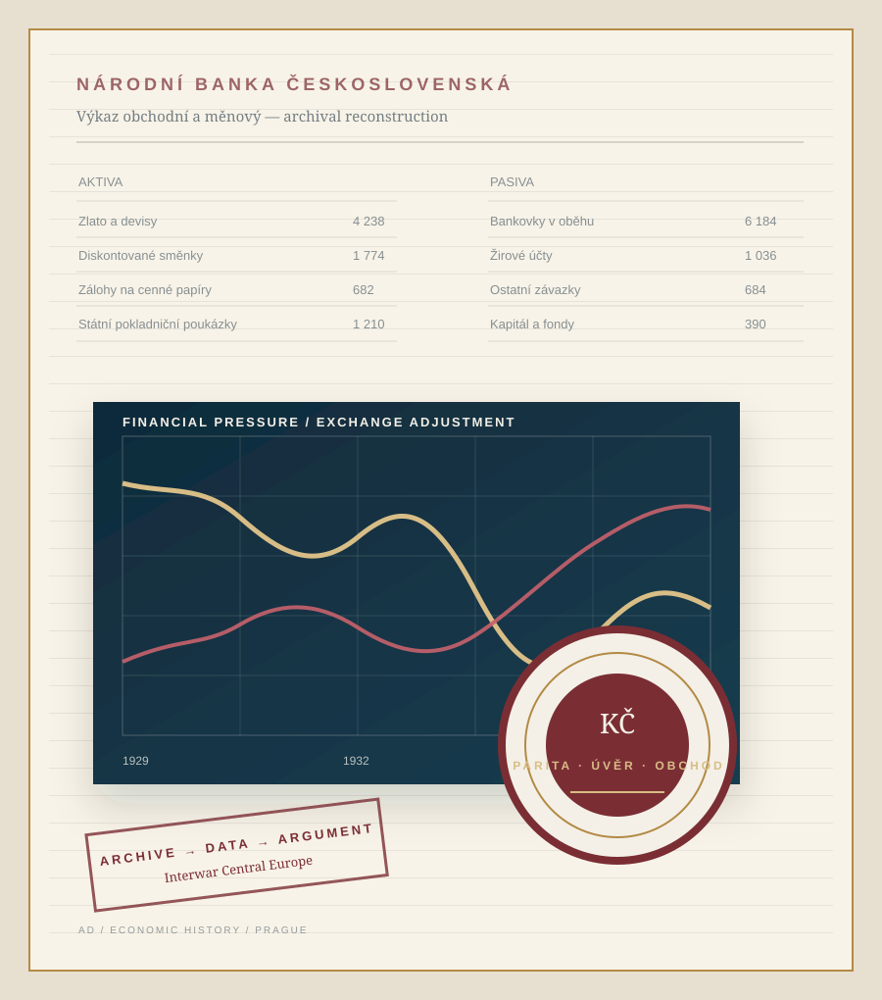

::: {.hero-shell}
::: {.hero-copy}

Economic historian · Prague

# Adam Dittrich, PhD

Assistant Professor · Economic History Prague University of Economics and Business

I study how monetary regimes, financial institutions, and economic ideas shaped adjustment in interwar Central Europe—especially Czechoslovakia. My work combines archival research, historical reconstruction, and cliometric methods.

::: {.hero-actions}
[Explore research](research.qmd){.button .button-primary}
[View publications](publications.qmd){.button .button-secondary}
[Download CV](assets/files/Adam-Dittrich-CV.pdf){.button .button-quiet}
:::

Monetary history · Financial history · International trade · Historical measurement · History of economic thought

:::

::: {.hero-visual aria-label="Abstract graphic combining an archival balance sheet, exchange-rate line, and monetary seal"}
{fig-alt="Abstract archival research graphic with a historical balance sheet, a line chart, and a monetary seal"}
:::
:::

::: {.signal-strip}
::: {.signal-item}
1920s–1930s
core historical period
:::
::: {.signal-item}
Monthly + bilateral
new historical evidence
:::
::: {.signal-item}
Archives + econometrics
integrated research design
:::
::: {.signal-item}
Central Europe
international questions
:::
:::

::: {.page-section .section-intro}

Research agenda

## A small economy under large constraints

Czechoslovakia provides unusually sharp evidence on the central dilemmas of the interwar economy: monetary credibility versus domestic recovery, financial stability versus deflation, and national policy autonomy within a fragmented international system. I use that case to address questions that travel beyond one country.
:::

::: {.research-grid}
::: {.research-card}

01

### Monetary regimes

How did gold-standard commitments, reserve rules, and central-bank strategy shape the timing and distribution of adjustment?

[Read the research theme →](research.qmd#monetary-regimes-and-central-banking)
:::

::: {.research-card}

02

### Financial stress

Can balance-sheet and market indicators recover the chronology of banking pressure before failures or institutional breaks become visible?

[Read the research theme →](research.qmd#financial-stress-and-banking)
:::

::: {.research-card}

03

### Trade and adjustment

How did devaluation, exchange controls, and changing relative prices affect trade adjustment during the Great Depression?

[Read the research theme →](research.qmd#trade-devaluation-and-commercial-reorganisation)
:::

::: {.research-card}

04

### Economic ideas

How did theories of value, causality, and economic order enter practical debates over currency, crisis, and state intervention?

[Read the research theme →](research.qmd#economic-thought-as-a-policy-institution)
:::
:::

::: {.page-section .featured-section}
::: {.section-heading-row}
::: {}

Selected work

## Selected research
:::
[All publications and papers →](publications.qmd){.text-link}
:::

::: {.project-stack}
::: {.project-feature}

Exchange ratesForthcoming · Statistika

### The Crown Against the World

Reconstructing Czechoslovakia’s effective exchange rates, 1920–1938, to examine monetary policy and international adjustment across the interwar period.

[Publication details](publications.qmd#forthcoming-and-accepted){.project-link}
:::

::: {.project-feature}

Financial historyResearch paper + open data

### Measuring Financial Stress under the Gold Standard

A monthly composite measure reconstructs the sequence of financial pressure in interwar Czechoslovakia and distinguishes monetary strain, banking tension, and the later real-economy trough.

[Project and data](data.qmd#financial-stress-under-the-gold-standard){.project-link}
:::

::: {.project-feature}

Business and social historyWorking paper · 2026

### Negative Time Preference and the Czech Sugar Industry

With Jiří Rytina, this project studies how industrial actors justified intertemporal sacrifice and social provision in the Czech sugar industry from 1896 to 1926.

[Working-paper record](https://ideas.repec.org/p/hal/wpaper/hal-05660879.html){.project-link}
:::
:::
:::

::: {.data-band}
::: {.data-band-copy}

Open historical evidence

## Data are part of the argument

My data work links historical sources to reproducible measurement. Public datasets cover financial stress in interwar Czechoslovakia, European bilateral trade, and monthly exchange rates and trade-balance adjustment in The Missing J, 1925–1936.

[Explore data and replication](data.qmd){.button .button-on-dark}
:::

::: {.data-band-stats}
::: {.data-stat}
11
financial-stress indicators
:::
::: {.data-stat}
21
European economies
:::
::: {.data-stat}
1925–36
monthly exchange-rate coverage
:::
:::
:::

::: {.page-section .news-section}
::: {.section-heading-row}
::: {}

Recent

## Research updates
:::
:::

::: {.news-list}
::: {.news-item}
16 Oct 2026

<strong>Conference presentation in České Budějovice.</strong> With Jiří Rytina and Jakub Drábek, I presented our work on healthcare infrastructure and health outcomes in socialist Czechoslovakia. <a href="publications.qmd#conference-presentations">Presentation and programme.</a>

:::
::: {.news-item}
Oct 2026

<strong>Forthcoming in <em>Statistika</em>.</strong> “The Crown Against the World: Reconstructing Czechoslovakia’s Effective Exchange Rates, 1920–1938.”

:::
::: {.news-item}
Sep 2026

<strong>PhD completed.</strong> I defended my dissertation on Czech economic apriorism on 29 September 2026. Since September, I have been an Assistant Professor in the Department of Economic History at Prague University of Economics and Business.

:::
::: {.news-item}
2026

<strong>Working paper released.</strong> “Negative Time Preference & the Czech Sugar Industry from 1896 to 1926,” with Jiří Rytina, is available through HAL Open Science.

:::
::: {.news-item}
2026

<strong>Replication project released.</strong> Monthly evidence for “Measuring Financial Stress under the Gold Standard” is archived in OpenICPSR.

:::
::: {.news-item}
2026

<strong>Monthly cliometric dataset.</strong> <a href="data.qmd#the-missing-j">The Missing J</a> brings together effective exchange rates, trade balances, prices, and activity for interwar Europe, 1925–1936.

:::
::: {.news-item}
2025

<strong>Two articles published.</strong> Joint research on the Czechoslovak sugar industry, deflation, and social provision appeared in <em>Listy cukrovarnické a řepařské [Czech Sugar and Sugar Beet Journal]</em>.

:::
:::
:::

::: {.closing-cta}

Research, data, collaboration

## Interested in interwar Central Europe?

I welcome exchanges on monetary and financial history, historical macroeconomic data, Czechoslovak sources, and comparative projects on the Great Depression.

[Contact me](contact.qmd){.button .button-primary}
:::
