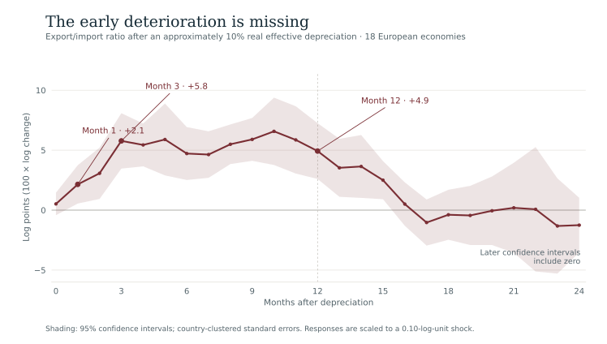
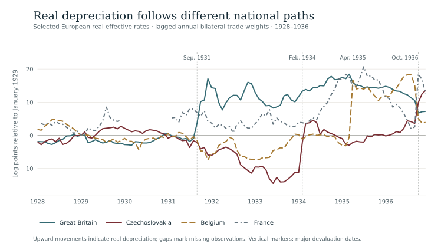
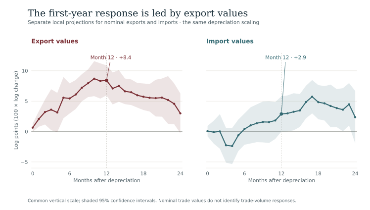
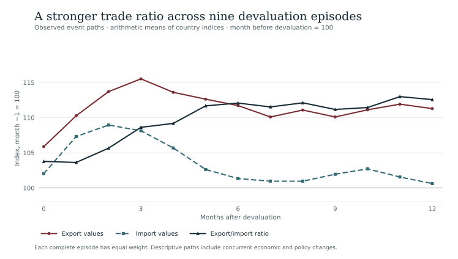
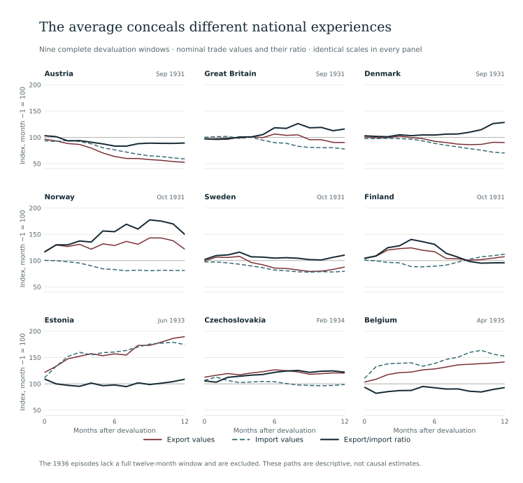
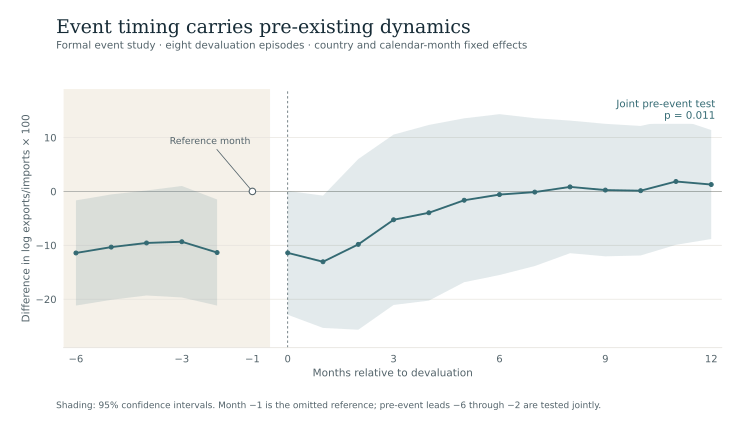
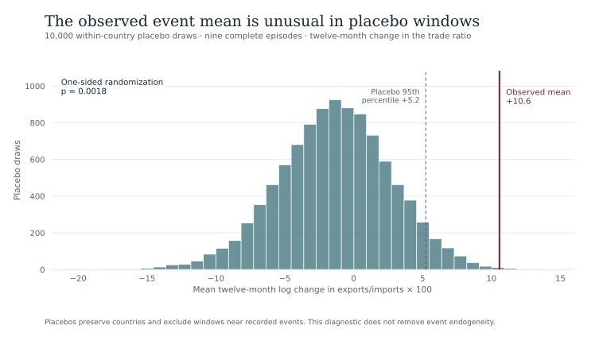

```{=html}
<main class="ac-page ds-page mj-page" id="missing-j-reader">
<p class="ac-back-link"><a href="data.html">← Datasets</a></p>
<p class="mj-eyebrow">Research data · Interwar Europe</p>
<h1>The Missing J<span>Trade adjustment in interwar Europe</span></h1>
<p class="ds-meta">Adam Dittrich · Monthly archive: 1925–1936 · Preferred European design: 1928–1936</p>
<p class="mj-intro"><strong>Export values move first. Imports catch up.</strong> The reported response to real depreciation is a rapid, temporary improvement in exports relative to imports. This dataset follows that adjustment across interwar Europe by linking monthly trade, currencies, prices and activity to reconstructed trading relationships.</p>
<p class="ds-lede">The research asks whether depreciation produced the familiar J-curve: an early deterioration in the trade balance followed by recovery. The average monthly path shows an improvement within the first year, with substantial differences across national devaluation episodes.</p>
<div class="ds-download-links"><a class="mj-download-primary" href="#downloads">Get the data</a><a href="#findings">Explore the findings</a><a href="https://doi.org/10.3886/E251239V1">openICPSR · V1</a></div>
<p class="mj-release"><strong>Reader edition · 23 October 2026.</strong> Figures reproduce the stored replication outputs. The interpretation also draws on the CSE conference paper dated 20 August 2026; its additional checks are identified separately. The DOI continues to identify the V1 deposit. <a href="#citation">Versions and citation</a>.</p>
<div class="ds-facts"><div><strong>18 economies</strong><span>The preferred European panel, within a broader monthly archive of 28 economies.</span></div><div><strong>+5.8</strong><span>Reported export/import response at three months, in log points.</span></div><div><strong>+4.9</strong><span>Reported response at twelve months; 95% intervals at 18 and 24 months include zero.</span></div></div>
<p class="ds-small">Responses are scaled to a 0.10-log-unit real depreciation, approximately 10%. See <a href="#units">units and interpretation</a>.</p>
<nav aria-label="On this page" class="ds-nav"><a href="#findings">Findings</a><a href="#coverage">Coverage</a><a href="#construction">Construction</a><a href="#components">Trade values</a><a href="#episodes">Devaluations</a><a href="#robustness">Robustness</a><a href="#event-evidence">Event evidence</a><a href="#downloads">Downloads</a></nav>
<p class="mj-mobile-hint">Swipe horizontally within a figure or table on small screens. Every figure also has a full-size version and downloadable data.</p>

<section class="level2 ds-section" id="findings"><h2>A temporary window of adjustment</h2>
<p>The main result is about timing. In the reported local projections, the export/import value ratio improves by <strong>5.77 log points at three months</strong> and <strong>4.93 at twelve months</strong> after a 0.10-log-unit real effective depreciation. By eighteen and twenty-four months, the estimates are statistically indistinguishable from zero. This is a first-year pattern of external adjustment, with no common initial monthly deterioration in the estimated path.</p>
<figure class="ds-figure" id="figure-1">
<div class="mj-chart-scroll" tabindex="0" role="region" aria-label="Figure 1. The reported export/import ratio response rises quickly, remains positive at twelve months and is indistinguishable from zero at eighteen and twenty-four months. Scroll horizontally on small screens."></div>
<figcaption><strong>Figure 1.</strong> The reported local-projection path for the log export/import ratio, scaled to a 0.10-log-unit real effective depreciation. The band is a 95% interval using country-clustered standard errors. These are the replication package’s stored estimates; the <a href="#calendar-check">calendar-alignment check</a> documents how gaps affect the source estimator’s horizon convention.<span class="ds-image-links"><a href="assets/files/datasets/missing-j/results/lp_baseline_lagged_bilateral_trade_balance.csv" download>Chart data (CSV)</a> · <a href="assets/files/datasets/missing-j/figures/missing-j-baseline-response.svg">Open full-size figure</a> · <a href="assets/files/datasets/missing-j/figures/missing-j-baseline-response.png" download>PNG</a></span></figcaption></figure>
<div class="ds-note" id="units"><strong>Reading the numbers.</strong> A log point is 100 times a natural-log change. The papers describe the results as approximate percentage responses to a 10% depreciation; the code scales a 0.10-log-unit shock. The reported 4.93-log-point response corresponds to about a 5.05% change in the ratio after exponentiation. It is neither a percentage-point change in the trade balance nor a measured increase in export volumes.</div>
<p>The conference paper places the strongest emphasis on <strong>months three to twelve</strong>. With only eighteen country clusters, its wild-cluster bootstrap makes the one-month estimate borderline at the 5% level (<em>p</em> = 0.051), while the three-, six- and twelve-month results remain statistically clear. These estimates describe a conditional relationship between depreciation and later trade values.</p>
<details><summary>Selected horizons, confidence intervals and sample sizes</summary>
<div class="ds-table-scroll" tabindex="0" role="region" aria-label="Reported response of the export/import value ratio"><table class="ds-table mj-table "><caption>Reported response of the export/import value ratio</caption><thead><tr><th scope="col">Horizon</th><th scope="col">Log points</th><th scope="col">95% confidence interval</th><th scope="col">Observations</th></tr></thead><tbody><tr><th scope="row">0</th><td class="num">+0.52</td><td class="num">-0.42 to 1.46</td><td class="num">1,757</td></tr>
<tr><th scope="row">1</th><td class="num">+2.15</td><td class="num">0.55 to 3.75</td><td class="num">1,739</td></tr>
<tr><th scope="row">3</th><td class="num">+5.77</td><td class="num">3.46 to 8.09</td><td class="num">1,703</td></tr>
<tr><th scope="row">6</th><td class="num">+4.72</td><td class="num">2.51 to 6.92</td><td class="num">1,649</td></tr>
<tr><th scope="row">12</th><td class="num">+4.93</td><td class="num">2.60 to 7.25</td><td class="num">1,541</td></tr>
<tr><th scope="row">18</th><td class="num">-0.38</td><td class="num">-2.47 to 1.70</td><td class="num">1,433</td></tr>
<tr><th scope="row">24</th><td class="num">-1.25</td><td class="num">-3.53 to 1.03</td><td class="num">1,325</td></tr>
</tbody></table></div>
<p class="ds-small">Intervals use the package’s country-clustered standard errors and normal critical value of 1.96. All seven horizons include 18 countries. The number of usable observations changes with the horizon. <a href="#calendar-check">The timing verification</a> explains the source estimator’s handling of gaps.</p>
</details>
<p class="mj-source">Sources: replication package, baseline local-projection CSV; CSE conference paper, Table 2 (p. 10) and Table 6 (p. 15). <a href="#citation">Full source and version details</a>.</p>
</section>

<section class="level2 ds-section" id="coverage"><h2>What is in the dataset?</h2>
<p>The processed archive contains <strong>4,032 country-month rows</strong>: 28 economies observed on a January 1925–December 1936 monthly grid. That grid includes missing series and observations outside the preferred European estimation sample. The <strong>18-country baseline begins in 1928</strong>, because monthly observations use the previous year’s bilateral weights and the annual weight reconstruction starts in 1927.</p>
<div class="mj-layers"><div><h3>Monthly observations</h3><p>Nominal exports and imports, wholesale prices, activity indicators, dollar exchange quotations and derived effective-rate measures.</p><p class="ds-small">Source period: 1925–1936.</p></div><div><h3>Trading relationships</h3><p>Annual export and import partner shares reconstructed from League of Nations trade reports, with alternative weighting designs.</p><p class="ds-small">Weight archive: 1927–1938.</p></div><div><h3>Research outputs</h3><p>Dynamic panel estimates, nine complete European event paths, country coverage and checks on measurement and inference.</p><p class="ds-small">Preferred design: 1928–1936.</p></div></div>
<p>The preferred panel covers Austria, Belgium, Bulgaria, Czechoslovakia, Denmark, Finland, France, Germany, Great Britain, Hungary, Italy, the Netherlands, Norway, Poland, Romania, Spain, Sweden and Switzerland.</p>
<details id="country-coverage"><summary>Country coverage and the difference between a data screen and a regression sample</summary>
<div class="ds-table-scroll" tabindex="0" role="region" aria-label="The 18 economies in the preferred European panel"><table class="ds-table mj-table "><caption>The 18 economies in the preferred European panel</caption><thead><tr><th scope="col">Country</th><th scope="col">Trade months</th><th scope="col">FX months</th><th scope="col">Screened months</th><th scope="col">Europe / world trade, 1928</th><th scope="col">Mean observed basket</th></tr></thead><tbody><tr><th scope="row">Austria</th><td class="num">144</td><td class="num">144</td><td class="num">108</td><td class="num">83.0%</td><td class="num">94.9%</td></tr>
<tr><th scope="row">Belgium</th><td class="num">144</td><td class="num">144</td><td class="num">108</td><td class="num">65.5%</td><td class="num">95.3%</td></tr>
<tr><th scope="row">Bulgaria</th><td class="num">107</td><td class="num">120</td><td class="num">82</td><td class="num">87.0%</td><td class="num">93.7%</td></tr>
<tr><th scope="row">Czechoslovakia</th><td class="num">144</td><td class="num">144</td><td class="num">108</td><td class="num">72.2%</td><td class="num">96.9%</td></tr>
<tr><th scope="row">Denmark</th><td class="num">144</td><td class="num">144</td><td class="num">108</td><td class="num">82.1%</td><td class="num">98.6%</td></tr>
<tr><th scope="row">Finland</th><td class="num">144</td><td class="num">144</td><td class="num">108</td><td class="num">79.4%</td><td class="num">98.5%</td></tr>
<tr><th scope="row">France</th><td class="num">144</td><td class="num">120</td><td class="num">94</td><td class="num">51.4%</td><td class="num">96.9%</td></tr>
<tr><th scope="row">Germany</th><td class="num">144</td><td class="num">144</td><td class="num">108</td><td class="num">52.9%</td><td class="num">94.5%</td></tr>
<tr><th scope="row">Great Britain</th><td class="num">144</td><td class="num">144</td><td class="num">108</td><td class="num">30.4%</td><td class="num">95.0%</td></tr>
<tr><th scope="row">Hungary</th><td class="num">144</td><td class="num">144</td><td class="num">108</td><td class="num">92.6%</td><td class="num">95.6%</td></tr>
<tr><th scope="row">Italy</th><td class="num">129</td><td class="num">120</td><td class="num">67</td><td class="num">48.8%</td><td class="num">96.4%</td></tr>
<tr><th scope="row">Netherlands</th><td class="num">144</td><td class="num">144</td><td class="num">108</td><td class="num">65.5%</td><td class="num">97.8%</td></tr>
<tr><th scope="row">Norway</th><td class="num">144</td><td class="num">132</td><td class="num">95</td><td class="num">70.9%</td><td class="num">98.2%</td></tr>
<tr><th scope="row">Poland</th><td class="num">144</td><td class="num">132</td><td class="num">95</td><td class="num">81.4%</td><td class="num">98.1%</td></tr>
<tr><th scope="row">Romania</th><td class="num">108</td><td class="num">144</td><td class="num">107</td><td class="num">87.7%</td><td class="num">94.0%</td></tr>
<tr><th scope="row">Spain</th><td class="num">137</td><td class="num">144</td><td class="num">101</td><td class="num">56.5%</td><td class="num">93.0%</td></tr>
<tr><th scope="row">Sweden</th><td class="num">144</td><td class="num">144</td><td class="num">108</td><td class="num">73.1%</td><td class="num">97.4%</td></tr>
<tr><th scope="row">Switzerland</th><td class="num">144</td><td class="num">144</td><td class="num">108</td><td class="num">70.8%</td><td class="num">93.2%</td></tr>
</tbody></table></div>
<p class="ds-small"><strong>Screened months</strong> reproduce the source table’s “LP obs.” column: 1,829 country-months passing its basic baseline screen. Adding lagged controls and future outcomes leaves 1,757 observations at horizon 0 and 1,541 at horizon 12. The flag <code>bilat_lagged_sample</code> is an eligibility screen, not a complete estimation flag for every horizon.</p>
<p class="ds-small"><strong>Europe / world trade</strong> measures the available European partners’ share of a country’s world trade in 1928. <strong>Mean observed basket</strong> measures how much of the already-defined European basket is observed in adjacent monthly exchange-rate and price records. They have different denominators. A high observed-basket share does not turn this European index into a worldwide effective rate.</p>
<p><a href="assets/files/datasets/missing-j/data/table_1_country_coverage_new_baseline.csv" download>Download country coverage</a></p>
</details>
<div class="ds-note"><strong>Trade values and historical units.</strong> The trade variables are seasonally adjusted nominal values from the monthly source panel. Their levels retain source-specific units. Within-country changes and export/import ratios are useful comparisons; adding the raw value columns across countries would mix different units and currencies.</div>
<p class="mj-source">Sources: processed monthly panel and country-coverage table; CSE conference paper, section 3.1 and Table 1 (pp. 5–7).</p>
</section>

<section class="level2 ds-section" id="construction"><h2>From dollar quotations to European competitiveness</h2>
<p>A depreciation against the dollar need not imply the same gain against a country’s trading partners. The preferred measure combines bilateral currency movements, relative wholesale prices and the changing geography of European trade.</p>
<div class="mj-steps"><div><span class="mj-step">01</span><h3>Build bilateral real changes</h3><p>Convert common dollar quotations into partner cross-rates, then adjust for home and partner wholesale prices. A positive change means real depreciation.</p></div><div><span class="mj-step">02</span><h3>Weight the partner basket</h3><p>Use each partner’s share of total bilateral exports plus imports. A month in year <em>t</em> uses the annual weights from <em>t</em> − 1.</p></div><div><span class="mj-step">03</span><h3>Chain observed changes</h3><p>Renormalize weights over partners observed in consecutive months and accumulate their weighted changes. Missing partners are not assigned zero movements.</p></div></div>
<figure class="ds-figure" id="figure-2">
<div class="mj-chart-scroll" tabindex="0" role="region" aria-label="Figure 2. Great Britain, Czechoslovakia, Belgium and France follow different real effective depreciation paths from 1928 to 1936. Scroll horizontally on small screens."></div>
<figcaption><strong>Figure 2.</strong> Selected chained real effective rates, expressed as 100 times the log change relative to January 1929. Upward movement means real depreciation. Vertical markers show the principal devaluation clusters. Missing French observations remain visible as gaps; lines do not interpolate them. The regression uses monthly changes, while this figure shows their accumulated path.<span class="ds-image-links"><a href="assets/files/datasets/missing-j/results/selected_effective_rate_paths.csv" download>Chart data (CSV)</a> · <a href="assets/files/datasets/missing-j/figures/missing-j-effective-rates.svg">Open full-size figure</a> · <a href="assets/files/datasets/missing-j/figures/missing-j-effective-rates.png" download>PNG</a></span></figcaption></figure>
<details id="estimation-details"><summary>Construction formulas and the local-projection specification</summary>
<div class="ds-equation"><code>Δq(i,j,t) = Δlog e(i,t) − Δlog e(j,t) + Δlog P(j,t) − Δlog P(i,t)</code><br/><code>Δqᴱ(i,t) = Σⱼ w̃(i,j,t−1) × Δq(i,j,t)</code></div>
<p>Here <em>e</em> is local currency per US dollar and <em>P</em> is the wholesale-price index. The annual total-trade weight is (exports to partner + imports from partner) divided by trade with the observed European partner set. The monthly weights are rescaled over partners with usable adjacent-month observations. The baseline screen requires at least <strong>60% of the European basket’s weight</strong> to be observed, alongside a usable trade outcome, depreciation measure and currency-unit screen.</p>
<p>The outcome is <code>log(exports) − log(imports)</code>. At each horizon, a separate regression relates its cumulative change from <em>t</em> − 1 to <em>t</em> + <em>h</em> to the current real effective depreciation. Controls include the lagged outcome, three lags of depreciation and outcome growth, current and two lagged changes in partner activity, country fixed effects and unrestricted calendar-month fixed effects. Standard errors are clustered by country.</p>
<p>Those calendar-month effects absorb shocks shared across countries in a particular month. They do not make the timing of devaluation random. The estimates remain conditional, reduced-form relationships.</p>
<p class="ds-small">Alternative constructions include fixed-1928 total-trade, export, import and equal-partner weights; nominal effective rates; a bilateral dollar real rate; and a <strong>Ljungberg partner-set proxy</strong>. That proxy borrows historical partner lists and constructs its own weights; it does not reproduce Ljungberg’s published index.</p>
</details>
<details id="calendar-check"><summary>Replication note: a check using exact calendar months</summary>
<p>The replication estimator filters to eligible observations before shifting rows to create lags and horizons. Where that filtered sample has a gap, a row shift can span more calendar months than its stated horizon. The stored paper estimates are preserved throughout the figures and result downloads.</p>
<p>For this reader edition, a separate verification retains the same eligibility screen but matches outcome endpoints and lagged controls by exact calendar month. It reproduces the stored estimates under the original convention, then checks the calendar-aligned alternative:</p>
<div class="ds-table-scroll" tabindex="0" role="region" aria-label="Reader verification: exact calendar offsets"><table class="ds-table mj-table "><caption>Reader verification: exact calendar offsets</caption><thead><tr><th scope="col">Horizon</th><th scope="col">Reported estimate</th><th scope="col">Calendar-aligned check</th><th scope="col">Check observations</th></tr></thead><tbody><tr><th scope="row">1</th><td class="num">2.15</td><td class="num">2.27</td><td class="num">1,714</td></tr><tr><th scope="row">3</th><td class="num">5.77</td><td class="num">5.81</td><td class="num">1,668</td></tr><tr><th scope="row">6</th><td class="num">4.72</td><td class="num">4.94</td><td class="num">1,599</td></tr><tr><th scope="row">12</th><td class="num">4.93</td><td class="num">5.14</td><td class="num">1,470</td></tr></tbody></table></div>
<p class="ds-small">Both columns are log-point responses to a 0.10-log-unit depreciation. The calendar-aligned twelve-month estimate is 5.14, with a country-clustered 95% interval of 2.76–7.52 and 1,470 observations. The 95% intervals at eighteen and twenty-four months still include zero. The qualitative first-year finding is unchanged. This verification is additional to the research papers; it does not retroactively replace their reported results.</p>
<p><a href="assets/files/datasets/missing-j/data/calendar-alignment-audit.csv" download>Verification results</a> · <a href="assets/files/datasets/missing-j/check_missing_j_calendar.py" download>Reproduce the check</a> · <a href="assets/files/datasets/missing-j/README.txt">Technical notes</a></p>
</details>
<p class="mj-source">Sources: replication code and processed weight files; CSE conference paper, sections 3.2–4.3 (pp. 5–9). The calendar check is documented separately in this reader edition.</p>
</section>

<section class="level2 ds-section" id="components"><h2>Export values move first</h2>
<p>Looking inside the ratio changes the interpretation. The reported export-value response is <strong>3.59 log points at three months</strong> and <strong>8.41 at twelve months</strong>. Import values are initially weaker and less precisely estimated, then rise later: their twelve-month point estimate is 2.89 log points, with a 95% interval that includes zero. By eighteen months the import response is positive and more clearly estimated.</p>
<figure class="ds-figure" id="figure-3">
<div class="mj-chart-scroll" tabindex="0" role="region" aria-label="Figure 3. Export-value responses become positive earlier; import values are initially weaker and rise later. Separate panels show 95 percent confidence intervals. Scroll horizontally on small screens."></div>
<figcaption><strong>Figure 3.</strong> Separate projections for nominal export and import values, with 95% country-clustered intervals and the same depreciation scaling as Figure 1. The outcome-specific lag controls differ, so the two estimated paths are not an exact accounting decomposition of the separately estimated export/import-ratio response.<span class="ds-image-links"><a href="assets/files/datasets/missing-j/results/lp_baseline_lagged_bilateral_exports.csv" download>Chart data (CSV)</a> · <a href="assets/files/datasets/missing-j/results/lp_baseline_lagged_bilateral_imports.csv" download>Import response data</a> · <a href="assets/files/datasets/missing-j/figures/missing-j-export-import-response.svg">Open full-size figure</a> · <a href="assets/files/datasets/missing-j/figures/missing-j-export-import-response.png" download>PNG</a></span></figcaption></figure>
<p>This timing is consistent with an early recovery in export earnings followed by a return of import demand. The data measure trade <em>values</em>, so the pattern cannot isolate quantities, unit values, invoice-currency effects or a structural trade elasticity. “Export-led” on this page means <strong>export-value-led</strong>.</p>
<p class="mj-source">Sources: export and import local-projection CSVs; CSE conference paper, Table 3 and section 5.2 (pp. 11–12).</p>
</section>

<section class="level2 ds-section" id="episodes"><h2>Nine devaluations, several adjustment paths</h2>
<p>Historical episodes put the panel estimates in context. The nine European cases with complete twelve-month windows cover Austria, Great Britain and Denmark in September 1931; Norway, Sweden and Finland in October 1931; Estonia in June 1933; Czechoslovakia in February 1934; and Belgium in April 1935.</p>
<figure class="ds-figure" id="figure-4">
<div class="mj-chart-scroll" tabindex="0" role="region" aria-label="Figure 4. Average indexed export values, import values and their ratio around nine European devaluations with complete twelve-month windows. Scroll horizontally on small screens."></div>
<figcaption><strong>Figure 4.</strong> Arithmetic means of the nine country-level indices, each normalized to 100 in the month before its devaluation. The mean of the ratio indices is calculated separately from the export and import means. These descriptive paths are not scaled to a common depreciation and are not the local projections in Figure 1.<span class="ds-image-links"><a href="assets/files/datasets/missing-j/results/table_A5_european_full_window_event_mean_paths.csv" download>Chart data (CSV)</a> · <a href="assets/files/datasets/missing-j/figures/missing-j-event-mean.svg">Open full-size figure</a> · <a href="assets/files/datasets/missing-j/figures/missing-j-event-mean.png" download>PNG</a></span></figcaption></figure>
<p>The mean twelve-month change in the export/import ratio is <strong>10.58 log points</strong>. That is an average of country-level log changes. Figure 4 instead averages the indexed levels, so its endpoint is a different summary. Neither number is an estimated response to a standardized 10% depreciation.</p>
<p>Great Britain has a modest J-like beginning before its ratio improves. Czechoslovakia’s February 1934 episode improves rapidly. Belgium’s export values rise, but its imports rise faster and the ratio falls. Austria’s path shows why a European average cannot stand in for a national history.</p>
<details id="all-event-paths"><summary>Explore all nine country paths on the same scale</summary>
<figure class="ds-figure" id="figure-5">
<div class="mj-chart-scroll" tabindex="0" role="region" aria-label="Figure 5. Nine country panels show varied trade adjustment after devaluation, including a rapid Czechoslovak improvement and a declining Belgian export/import ratio. Scroll horizontally on small screens."></div>
<figcaption><strong>Figure 5.</strong> Nine complete event windows on identical vertical scales; the month before devaluation equals 100. The common scale makes the national differences comparable. The Czechoslovak panel is the February 1934 episode. Late-1936 devaluations do not have a complete twelve-month follow-up before the monthly panel ends.<span class="ds-image-links"><a href="assets/files/datasets/missing-j/results/curated_devaluation_event_windows.csv" download>Chart data (CSV)</a> · <a href="assets/files/datasets/missing-j/figures/missing-j-country-event-paths.svg">Open full-size figure</a> · <a href="assets/files/datasets/missing-j/figures/missing-j-country-event-paths.png" download>PNG</a></span></figcaption></figure>
<div class="ds-table-scroll" tabindex="0" role="region" aria-label="Twelve-month changes after the nine complete European episodes"><table class="ds-table mj-table "><caption>Twelve-month changes after the nine complete European episodes</caption><thead><tr><th scope="col">Country</th><th scope="col">Empirical event month</th><th scope="col">Export values</th><th scope="col">Import values</th><th scope="col">Export/import ratio</th></tr></thead><tbody><tr><th scope="row">Austria</th><td>1931-09</td><td class="num">-64.2</td><td class="num">-52.8</td><td class="num">-11.4</td></tr>
<tr><th scope="row">Great Britain</th><td>1931-09</td><td class="num">-10.4</td><td class="num">-25.1</td><td class="num">+14.7</td></tr>
<tr><th scope="row">Denmark</th><td>1931-09</td><td class="num">-10.4</td><td class="num">-35.4</td><td class="num">+25.0</td></tr>
<tr><th scope="row">Norway</th><td>1931-10</td><td class="num">+19.6</td><td class="num">-20.8</td><td class="num">+40.4</td></tr>
<tr><th scope="row">Sweden</th><td>1931-10</td><td class="num">-13.0</td><td class="num">-22.9</td><td class="num">+9.9</td></tr>
<tr><th scope="row">Finland</th><td>1931-10</td><td class="num">+7.2</td><td class="num">+11.4</td><td class="num">-4.2</td></tr>
<tr><th scope="row">Estonia</th><td>1933-06</td><td class="num">+64.0</td><td class="num">+55.7</td><td class="num">+8.3</td></tr>
<tr><th scope="row">Czechoslovakia</th><td>1934-02</td><td class="num">+18.7</td><td class="num">-1.4</td><td class="num">+20.0</td></tr>
<tr><th scope="row">Belgium</th><td>1935-04</td><td class="num">+34.8</td><td class="num">+42.2</td><td class="num">-7.4</td></tr>
</tbody></table></div>
<p class="ds-small">Table entries are 100 × log changes from month −1 to month +12. They differ from the exact indexed level changes plotted above. Export and import changes in this event table form an accounting identity with the ratio change, unlike the separately estimated local projections.</p>
</details>
<details><summary>Event dates, full-month conventions and the late-1936 cases</summary>
<p>The event universe follows the devaluation column in Bernanke and James (1991), Table 2.1. For Norway and Sweden, historical September 1931 dates are assigned to October observations; Belgium’s March 1935 change is assigned to April. These conventions use the first full monthly post-devaluation window.</p>
<p>Late-1936 episodes do not supply a full twelve-month follow-up before the sample ends. The second Czechoslovak devaluation in October 1936, for example, has only two subsequent months. The event-universe file preserves these cases, source dates and inclusion rules. Gold suspension, exchange controls and devaluation are distinct historical events; the chronology should be read with those distinctions in mind.</p>
<p><a href="assets/files/datasets/missing-j/diagnostics/table_A1_event_universe.csv" download>Event universe and inclusion rules</a> · <a href="assets/files/datasets/missing-j/results/table_A7_european_event_h12_country_summary.csv" download>Twelve-month country results</a></p>
</details>
<p class="mj-source">Sources: event-window and event-summary files; Bernanke and James (1991), Table 2.1; CSE conference paper, section 7 and Table 7 (pp. 15–16).</p>
</section>

<section class="level2 ds-section" id="robustness"><h2>What changes when the sample is held fixed?</h2>
<p>The conference version makes a useful distinction between changing the exchange-rate measure and changing the observations. A fixed-1928 basket can be extended back to 1925, while the preferred lagged-weight design begins in 1928. Comparing their longest available samples changes both the measure and the years.</p>
<p>With the <strong>same country-month observations</strong>, the conference paper reports twelve-month responses between <strong>4.93 and 5.31 log points</strong> across six measures:</p>
<div class="ds-table-scroll" tabindex="0" role="region" aria-label="One-year response with the same country-month observations"><table class="ds-table mj-table mj-comparison"><caption>One-year response with the same country-month observations</caption><thead><tr><th scope="col">Exchange-rate measure</th><th scope="col">Response, log points</th></tr></thead><tbody><tr><th scope="row">Lagged annual total-trade weights</th><td class="num">4.93</td></tr><tr><th scope="row">Fixed 1928 total-trade weights</th><td class="num">5.16</td></tr><tr><th scope="row">Fixed 1928 export weights</th><td class="num">4.94</td></tr><tr><th scope="row">Fixed 1928 import weights</th><td class="num">5.31</td></tr><tr><th scope="row">Equal partner weights</th><td class="num">5.31</td></tr><tr><th scope="row">Bilateral real rate against USD</th><td class="num">5.16</td></tr></tbody></table></div>
<p class="mj-source">Source: CSE conference paper, Table 4 (p. 13). Values are transcribed from the paper. The extension code and machine-readable conference outputs were not included in the replication package; these entries are reported results, separate from the reproduced baseline outputs. <a href="assets/files/datasets/missing-j/conference/reported-checks.csv" download>Download the source-labelled transcription</a>.</p>
<p>The package’s older fixed-weight estimate of 1.60 uses a different, longer sample. The conference comparison shows why that smaller estimate should not be attributed to the weights alone.</p>
<div class="mj-two-columns"><div><h3>A more conservative inference check</h3><p>The conference paper uses 999 null-imposed wild-cluster bootstrap draws, with country-level weights and re-studentized statistics. This is useful with eighteen country clusters.</p><div class="ds-table-scroll" tabindex="0" role="region" aria-label="Inference with 18 country clusters"><table class="ds-table mj-table "><caption>Inference with 18 country clusters</caption><thead><tr><th scope="col">Horizon</th><th scope="col">Response, log points</th><th scope="col">Wild-cluster p-value</th></tr></thead><tbody><tr><th scope="row">1</th><td class="num">2.15</td><td class="num">0.051</td></tr><tr><th scope="row">3</th><td class="num">5.77</td><td class="num">0.003</td></tr><tr><th scope="row">6</th><td class="num">4.72</td><td class="num">0.001</td></tr><tr><th scope="row">12</th><td class="num">4.93</td><td class="num">0.001</td></tr></tbody></table></div><p class="ds-small">The one-month point estimate remains positive, but its bootstrap <em>p</em>-value is just above 0.05. The strongest first-year result starts at month three. Source: CSE Table 6 (p. 15).</p></div><div><h3>Beyond one weighting choice</h3><p>The conference paper also reports positive first-year results with country-specific trends, different lag lengths, and exclusion of the six countries devaluing in September–October 1931.</p><p>In the replication package, removing any single country leaves the twelve-month estimate between <strong>4.15 and 5.50 log points</strong>. The positive panel result does not depend on one national case.</p><p><a href="assets/files/datasets/missing-j/diagnostics/table_9_leave_one_country_out_h12.csv" download>Leave-one-country-out results</a></p></div></div>
<details><summary>More conference checks and the dollar-rate comparison</summary>
<div class="ds-table-scroll" tabindex="0" role="region" aria-label="Additional design checks reported in the conference paper"><table class="ds-table mj-table mj-comparison"><caption>Additional design checks reported in the conference paper</caption><thead><tr><th scope="col">Specification</th><th scope="col">One-year response, log points</th></tr></thead><tbody><tr><th scope="row">Baseline</th><td class="num">4.93</td></tr><tr><th scope="row">Country-specific linear trends</th><td class="num">3.97</td></tr><tr><th scope="row">Exclude Sep.-Oct. 1931 devaluation countries</th><td class="num">3.97</td></tr><tr><th scope="row">One lag</th><td class="num">4.51</td></tr><tr><th scope="row">Six lags</th><td class="num">4.69</td></tr><tr><th scope="row">Twelve lags</th><td class="num">3.88</td></tr></tbody></table></div>
<p>The conference normalized-balance check uses <code>(X − M) / (X + M)</code> and reports a twelve-month change of <strong>2.40 percentage points</strong>. That has a different unit from the log export/import responses above. Source: CSE Table 5 (p. 14); reported conference results.</p>
<p>The European effective-rate shock and the bilateral dollar real-rate shock are conceptually different, yet their estimated paths are close. In 1,827 common observations, the package reports a raw correlation of 0.755 and a correlation of 0.980 after country and calendar-month effects are removed. Shared partner movements account for much of the difference between the measures before those effects are absorbed.</p>
<p><a href="assets/files/datasets/missing-j/diagnostics/diagnostic_exchange_rate_measure_correlation.csv" download>Exchange-rate correlation diagnostic</a></p>
</details>
</section>

<section class="level2 ds-section" id="event-evidence"><h2>The historical timing carries information</h2>
<p>Devaluations were responses to monetary and economic pressure. The formal event study makes that selection visible: trade ratios were already moving before the event, and the joint pretrend test rejects jointly zero pre-event coefficients (<em>p</em> = 0.011).</p>
<figure class="ds-figure" id="figure-6">
<div class="mj-chart-scroll" tabindex="0" role="region" aria-label="Figure 6. The formal event study shows significant pre-devaluation movement and varied post-devaluation coefficients. Scroll horizontally on small screens."></div>
<figcaption><strong>Figure 6.</strong> A country- and calendar-month fixed-effects event study of log exports/imports, with month −1 omitted. It uses eight European episodes: Estonia is outside the 18-country regression panel. The joint test of leads −6 through −2 gives <em>p</em> = 0.011. The bands reproduce the stored country-clustered 95% intervals.<span class="ds-image-links"><a href="assets/files/datasets/missing-j/results/table_5_formal_event_study_coefficients.csv" download>Chart data (CSV)</a> · <a href="assets/files/datasets/missing-j/results/table_A4_event_pretrend.csv" download>Pretrend test</a> · <a href="assets/files/datasets/missing-j/figures/missing-j-formal-event-study.svg">Open full-size figure</a> · <a href="assets/files/datasets/missing-j/figures/missing-j-formal-event-study.png" download>PNG</a></span></figcaption></figure>
<p>The event study uses <strong>eight episodes</strong>, while the descriptive figures use nine. Estonia has a complete trade path but lies outside the preferred 18-country regression panel. At twelve months, the formal event-study coefficient is 1.28 log points, with a wide 95% interval of −8.83 to 11.38. This estimate differs from both the descriptive nine-event mean and the depreciation response in the main panel model.</p>
<details><summary>How unusual were the actual dates? The placebo comparison</summary>
<figure class="ds-figure" id="figure-7">
<div class="mj-chart-scroll" tabindex="0" role="region" aria-label="Figure 7. The observed nine-event mean of 10.6 log points lies in the right tail of 10,000 within-country placebo draws. Scroll horizontally on small screens."></div>
<figcaption><strong>Figure 7.</strong> The actual mean twelve-month change in log exports/imports (10.6 log points) compared with 10,000 within-country random-date draws. The one-sided randomization value is 0.0018, rounded to 0.002 in the papers. This describes the unusual timing of the actual episodes; it does not establish random assignment of devaluation.<span class="ds-image-links"><a href="assets/files/datasets/missing-j/results/placebo_event_randomization_europe_distribution.csv" download>Chart data (CSV)</a> · <a href="assets/files/datasets/missing-j/results/table_A6_european_event_placebo_randomization.csv" download>Diagnostic summary</a> · <a href="assets/files/datasets/missing-j/figures/missing-j-placebo-distribution.svg">Open full-size figure</a> · <a href="assets/files/datasets/missing-j/figures/missing-j-placebo-distribution.png" download>PNG</a></span></figcaption></figure>
<p class="ds-small">The placebo dates are sampled within countries from eligible complete windows. Crisis months and tranquil months are not necessarily exchangeable. A small randomization value therefore strengthens the historical description of these particular episodes without turning them into an experiment.</p>
</details>
<div class="ds-note"><strong>Scope of the finding.</strong> The evidence describes the monthly path of aggregate nominal trade values, conditional on the reported controls. It cannot resolve an adverse phase shorter than a month, separate prices from quantities, identify an exogenously assigned policy effect, or measure the consequences for world welfare. National adjustment and international spillovers are separate research questions.</div>
<p class="mj-source">Sources: formal event coefficients, pretrend test and placebo outputs; CSE conference paper, sections 7–8 (pp. 15–18), Appendix Table A2 (p. 23) and Figure A4 (p. 26).</p>
</section>

<section class="level2 ds-section ds-download" id="downloads"><h2>Work with the data</h2>
<p>Start with the compact monthly panel and its dictionary, or download the reader bundle for the complete set of figures, chart inputs, processed source panel, partner weights, diagnostics and reproduction scripts.</p>
<div class="ds-download-links"><a class="mj-download-primary" href="assets/files/datasets/missing-j/missing-j-reader-data.zip" download>Download reader bundle · ZIP</a><a href="assets/files/datasets/missing-j/data/reader-monthly-panel.csv" download>Monthly reader panel · CSV</a><a href="assets/files/datasets/missing-j/data/reader-data-dictionary.csv" download>Variable dictionary · CSV</a></div>
<div class="ds-table-scroll" tabindex="0" role="region" aria-label="Available downloads"><table class="ds-table mj-table mj-comparison"><caption>Choose the level of detail you need</caption><thead><tr><th scope="col">File</th><th scope="col">What it contains</th></tr></thead><tbody>
<tr><th scope="row"><a href="assets/files/datasets/missing-j/data/reader-monthly-panel.csv" download>Compact monthly panel</a></th><td>4,032 original country-month rows with a documented selection of core variables. Values are copied without rounding; missing cells remain missing.</td></tr>
<tr><th scope="row"><a href="assets/files/datasets/missing-j/data/interwar_jcurve_effective_panel.csv" download>Original processed panel</a></th><td>The unmodified 161-column file distributed in the replication package, including alternative measures and stored sample flags.</td></tr>
<tr><th scope="row"><a href="assets/files/datasets/missing-j/data/annual_bilateral_trade_weights_europe_1927_1938.csv" download>Annual bilateral weights</a></th><td>European partner weights, 1927–1938. <a href="assets/files/datasets/missing-j/data/effective_rate_partner_weights_used_bilat_lagged.csv" download>Weights used by the lagged design</a> are also available.</td></tr>
<tr><th scope="row"><a href="assets/files/datasets/missing-j/results/curated_devaluation_event_windows.csv" download>Event-window data</a></th><td>Stored event paths, including cases beyond the nine complete European windows. Use the <a href="assets/files/datasets/missing-j/diagnostics/table_A1_event_universe.csv">event universe</a> for inclusion rules.</td></tr>
<tr><th scope="row"><a href="assets/files/datasets/missing-j/build_missing_j_figures.py" download>Figure reproduction script</a></th><td>Rebuilds the seven SVG and PNG figures from the bundled chart data without re-estimating the models.</td></tr>
<tr><th scope="row"><a href="assets/files/datasets/missing-j/check_missing_j_calendar.py" download>Calendar-alignment verification</a></th><td>Reproduces selected reported baseline estimates and checks exact calendar offsets using the processed panel.</td></tr>
<tr><th scope="row"><a href="assets/files/datasets/missing-j/conference/reported-checks.csv" download>Conference result transcription</a></th><td>Common-sample, design and small-cluster results with table/page locators. These are transcribed reported results.</td></tr>
<tr><th scope="row"><a href="assets/files/datasets/missing-j/README.txt">Reader guide</a></th><td>Units, file map, reproduction commands, source provenance, version notes and known implementation details. <a href="assets/files/datasets/missing-j/checksums.json">SHA-256 checksums</a> verify file integrity.</td></tr>
</tbody></table></div>
<p class="ds-small">This is a companion snapshot of processed data and reader materials. The <a href="https://www.openicpsr.org/openicpsr/project/251239/version/V1/view">openICPSR V1 record</a> remains the archival dataset reference. The website bundle is not a new DOI version or the complete conference replication archive.</p>
</section>

<section class="level2 ds-section" id="citation"><h2>Sources, versions and citation</h2>
<p class="ds-reference">Dittrich, Adam. 2026. <em>The Missing J in Interwar Europe: A Monthly Cliometric Dataset on Effective Exchange Rates and Trade-Balance Adjustment, 1925–1936.</em> openICPSR, V1. <a href="https://doi.org/10.3886/E251239V1">https://doi.org/10.3886/E251239V1</a>.</p>
<p>If you use the website files, also identify <strong>the reader edition dated 23 October 2026</strong> and the files used. The website files form a separately documented snapshot. Cite this reader edition when using them.</p>
<p>The conference source is Dittrich’s <em>The Missing J: Fast, Export-Value-Led Trade Adjustment in Interwar Europe, 1928–1936</em>, dated 20 August 2026 and prepared for the 14th Biennial Conference of the Czech Economic Society. It refines the interpretation and adds checks beyond those present in the replication package. The conference paper and dataset manuscript are documented here as research versions.</p>
<div class="ds-table-scroll" tabindex="0" role="region" aria-label="Underlying sources"><table class="ds-table mj-table mj-comparison"><caption>Where the observations come from</caption><thead><tr><th scope="col">Component</th><th scope="col">Source and role</th></tr></thead><tbody>
<tr><th scope="row">Monthly trade, prices and activity</th><td>Albers and Uebele (2015), monthly interwar panel; Albers (2018), <em>Explorations in Economic History</em> 70: 150–163.</td></tr>
<tr><th scope="row">Currency quotations</th><td>Board of Governors of the Federal Reserve System (1943), <em>Banking and Monetary Statistics, 1914–1941</em>, Table 173. FRASER is the access route.</td></tr>
<tr><th scope="row">Bilateral trade weights</th><td>Adam Dittrich’s reconstruction from League of Nations Economic Intelligence Service international trade reports, including <em>International Trade Statistics</em> and <em>Review of World Trade</em>.</td></tr>
<tr><th scope="row">Devaluation chronology</th><td>Bernanke and James (1991), “The Gold Standard, Deflation, and Financial Crisis in the Great Depression,” Table 2.1; supplemental gold-bloc cases follow the package’s documented sources.</td></tr>
<tr><th scope="row">Dynamic method</th><td>Local projections following Jordà (2005), with the historical data construction and specification documented in the research manuscripts.</td></tr>
</tbody></table></div>
<p><a href="assets/files/datasets/missing-j/citations.bib" download>Download citations · BibTeX</a> · <a href="assets/files/datasets/missing-j/source-map.csv" download>File provenance · CSV</a> · <a href="publications.html#missing-j-paper">Research manuscript</a></p>
<div class="mj-related"><a href="czechoslovakia-eer.html">Czechoslovak effective exchange rates</a><a href="czechoslovak-foreign-trade.html">Czechoslovak foreign trade</a><a href="czechoslovakia-financial-stress.html">Czechoslovak financial stress</a></div>
</section>
<p class="mj-top-link"><a href="#missing-j-reader">Back to top ↑</a></p>
</main>
```
